# Agent Threads

Long agent sessions are hard to look back through. The answer you got an hour ago sits under pages of tool calls. Agent Threads opens a pane beside your agent's terminal that shows only the conversation, as a chat: each prompt you sent in a bubble, the reply under it, grouped by day. It works with Claude Code, Codex, OpenCode, Pi, Cursor and Antigravity. It reads the session on your computer and sends nothing over the network.

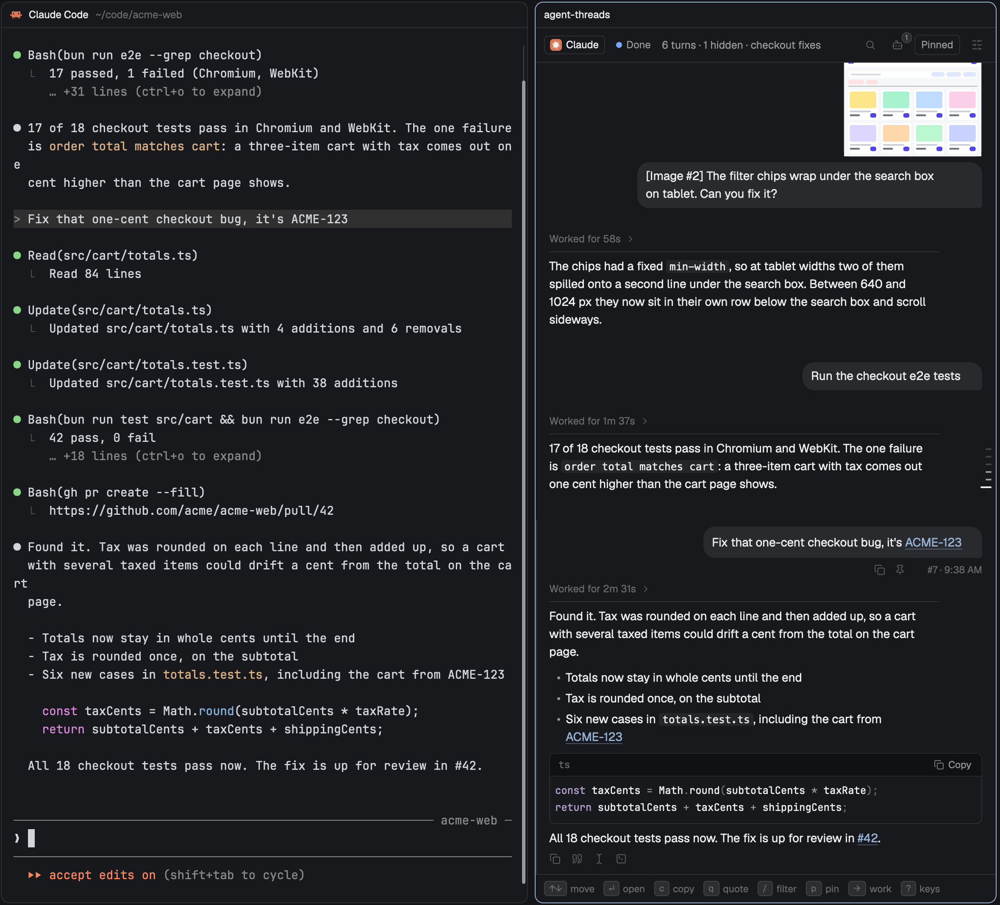

## Install

You need the [Herdr](https://herdr.dev) app and `jq`.

```sh
git clone https://github.com/ryanrozich/herdr-agent-threads
cd herdr-agent-threads
./install.sh
```

Then add the chord to `~/.config/herdr-app/keys.json`:

```json
{ "global": { "cmd-shift-t": "mod.open:agent-threads" } }
```

Some agents need a few more command-line tools. [Install in detail](docs/usage.md#install-in-detail) lists them.

## Quick start

1. In a terminal running your agent, press `Cmd-Shift-T`. The pane opens to the right. Press it again to move between the pane and the terminal.
2. Move with `↑` `↓`. Press `Enter` to open a turn and read the whole reply. `Esc` closes it.
3. Press `/` and type to search.
4. Press `o` for the outline, one row per turn, to find an older turn fast.
5. Press `p` to pin a turn you want to come back to. `1` to `5` take you back.
6. Press `q` to quote the reply into your prompt, or `c` to copy it.
7. Press `?` to see every key.

## What you can do

### Read a long session as a chat

Your prompt is a quiet bubble on the right. A grey line under it says how long the agent worked, and the reply follows. Every message shows in full unless you turn on Shorten long messages in the settings. Point at a message for its time, and select a turn for the copy, pin and quote icons. A band marks each day. Open a turn to see the whole reply, with code, lists and links formatted. A code block wraps and shows its first 12 rows, with Show all under it for the rest. A Mermaid block has View diagram under it, which opens the diagram drawn as text in a viewer over the window.

On Herdr 0.1.13 or newer, drag across any turn's text, open or closed, to highlight it, and press `Cmd-C` to copy it. A drag or a double press never opens or closes a turn; only a click that does not move does. A click on a closed turn opens it after 0.3 s, so a double press can select a word first.

<a href="docs/screenshots/open-turn.png">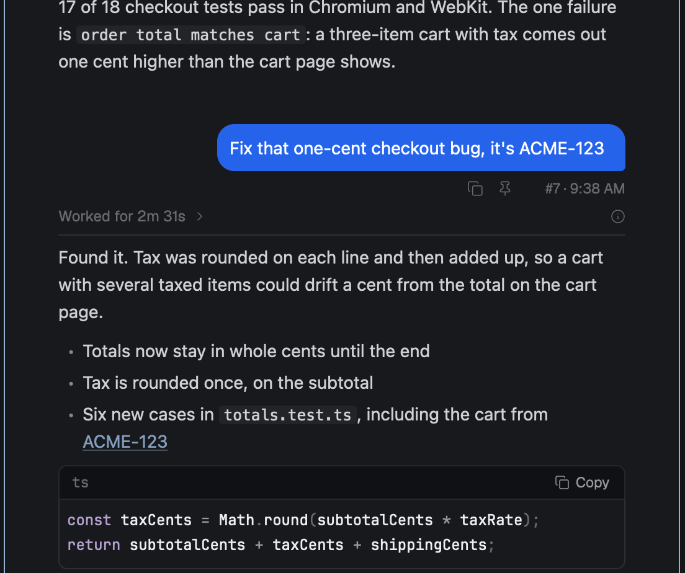</a>

### See what the agent did

In an open turn, click the grey line to see the work before the reply: what the agent said along the way, and each run of tool calls. For every agent but Cursor, open a run to see each command, file or search, and click one to see its output: its first 12 rows, with Show all for the rest. An output over 400 lines has a link that opens all of it in a viewer over the window, with numbered lines. A run's calls are read from the transcript only when you open it, and kept in memory only. `→` and `←` open and close the work a level at a time.

<a href="docs/screenshots/work.png">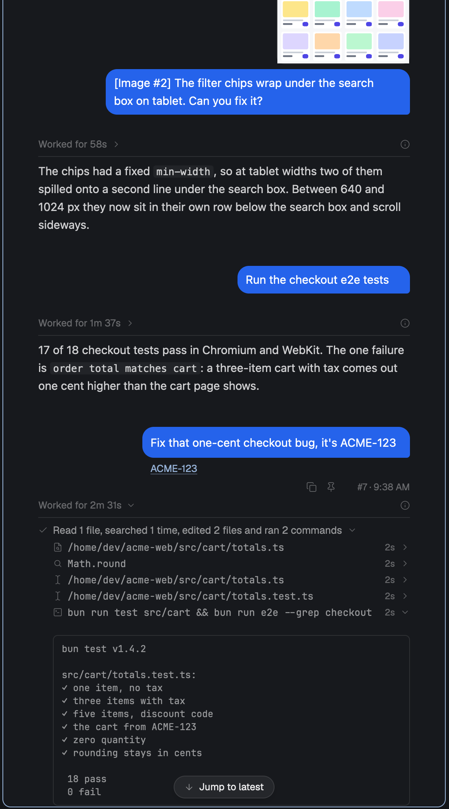</a>

### Follow subagents

Subagents get a line of their own in a turn's work, such as "Ran 4 subagents". While any still works, the line says how many ("2 working"), even after the reply, and it says how many failed. Open it to see each subagent: a check when it is back, a red cross when it failed, how long it took, and its model when it is not the turn's. While a turn runs, its subagents show without a click. Only Claude Code records each subagent's state; for the other agents the line lists the calls.

### See a turn's numbers

Press `i` for the Turn card of the selected turn: the model and effort, the tokens, the tool calls and the cache hit, each with a sentence on what it means. It also says when the conversation was compacted during the turn. Rest the pointer on the small info icon at the end of a turn's "Worked for" line to see the same card. While the card is open, `↑` and `↓` move it to the next turn, so you can compare turns. `i` or `Esc` closes it.

### Find an answer

Press `/` and type. The list narrows to the turns that match. `g` jumps to a turn number, and `[` `]` move a day at a time.

The rail on the list's right edge (or left, in the settings) has a tick for each turn. Point at a tick for a card with the turn's day, time and number, the start of your prompt and the start of the reply; `p` pins that turn while the card is open. Click a tick to go to the turn: its top lands level with the tick, and the turn flashes for a moment. In a long session the rail shows a window of ticks that follows the list, and the wheel on the rail moves that window. A narrow pane hides the rail.

<a href="docs/screenshots/search.png">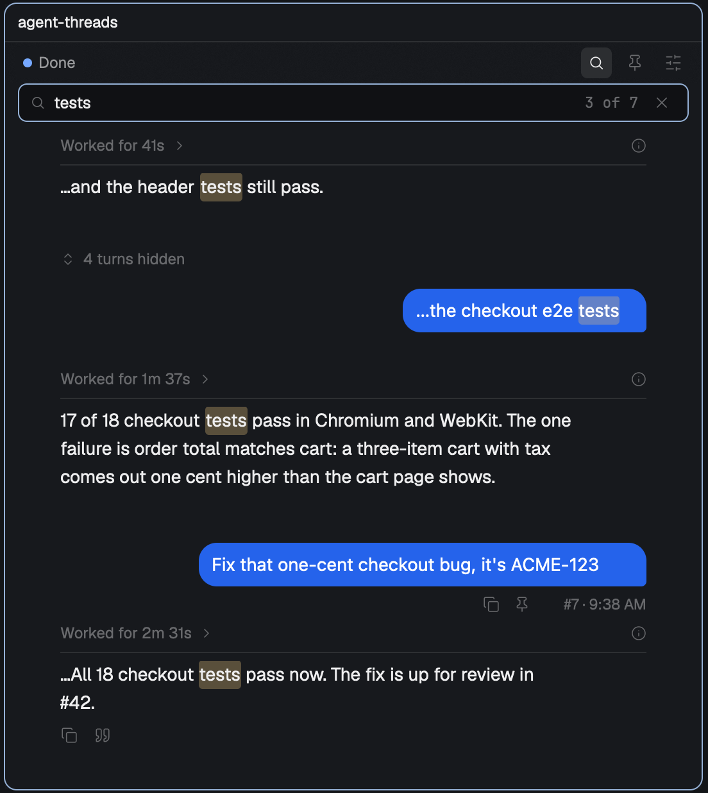</a>

### See the whole session at a glance

Press `o` for the outline. Each turn is one line, so a few days fit on one screen. `Enter` opens the turn in the list.

<a href="docs/screenshots/outline.png">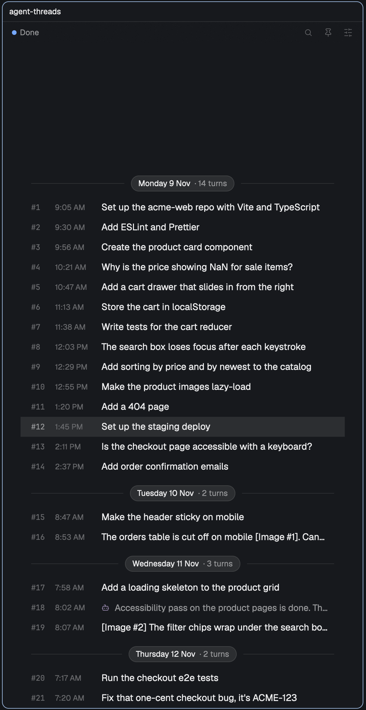</a>

### Pin the turns you need

Press `p` to pin a turn. Your pins show in a column beside the list, oldest first, numbered 1 to 7. Press a number to go back to that turn. The unpin button at the right of a pin, on hover or on the selected pin, unpins it, and `u` undoes an unpin. `-` and `=` make the Pinned column narrower or wider, and Threads takes or gives the difference so the terminal keeps its width.

<a href="docs/screenshots/pinned.png">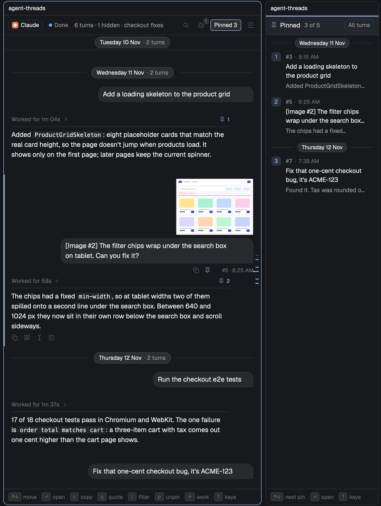</a>

### See what the agent did, step by step

Press `y` for the Trajectory: a pane beside the chat with one row per step of each turn. Your message, each text the agent wrote, each tool call, the reply. Each row has when it started in the turn, how long it took and a small bar for that. Failed calls are red, and `f` steps through them. `m` steps through your own messages. The buttons at the top hide or show the input, model and tool rows. `Enter` shows a row's detail. The Chat and the Trajectory select the same turn. In a pane under 480 px wide, the Trajectory shows in the same pane, and `y`, `Esc` or its Chat button goes back.

### Quote a reply back to the agent

Press `q`. The reply goes into your prompt as a `>` quote, with a blank line under it for your comment. Agent Threads never presses Enter for you. To quote only part of a reply, select it, press `Cmd-C`, then `q`.

<a href="docs/screenshots/quote.png">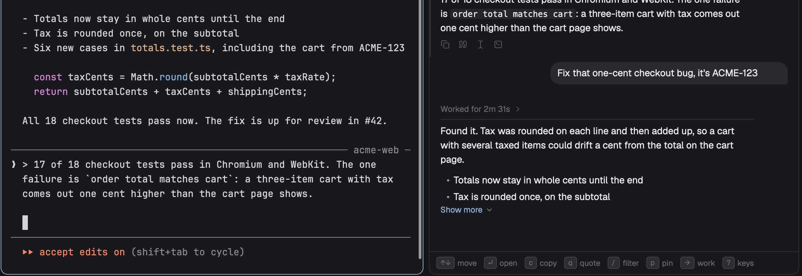</a>

### Know what the agent is doing

At the top left of the pane, the agent's state says Working, Needs you, Done or Exited. Click it to go to the terminal. Only Claude Code reports its state live; for the other agents the state shows only Done or Exited, and nothing while a turn runs. Search, Pinned and Settings show at the top right while the pointer is in the pane. While you read further up, a Jump to latest pill floats at the bottom of the list, with a dot when something new arrived below.

<a href="docs/screenshots/panel.png">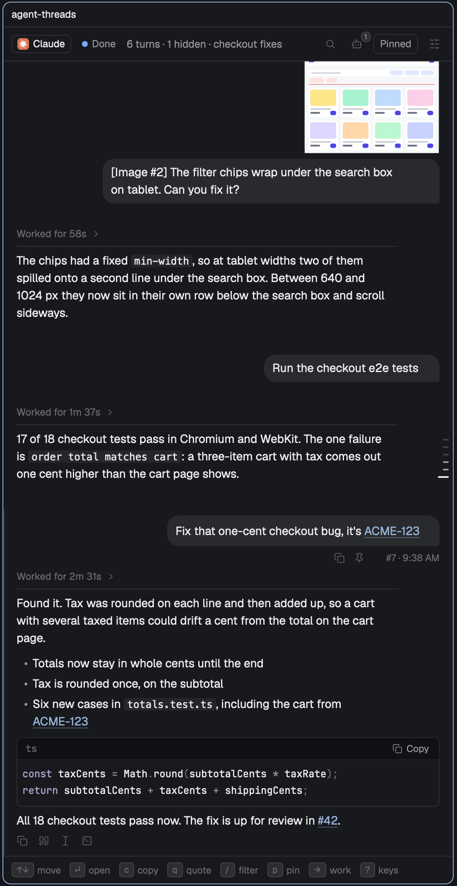</a>

### Check a reply against its screenshots

Images you pasted show as tiles over your message. Click a tile to open the image viewer at that image, on a closed turn, an open one or the running one. The viewer fills the window with the image and puts your prompt and the reply beside it, so you can read the reply against each screenshot. `←` `→` step through the images, `j` `k` scroll the reply, `i` hides it and `Esc` closes the viewer.

<a href="docs/screenshots/images.png">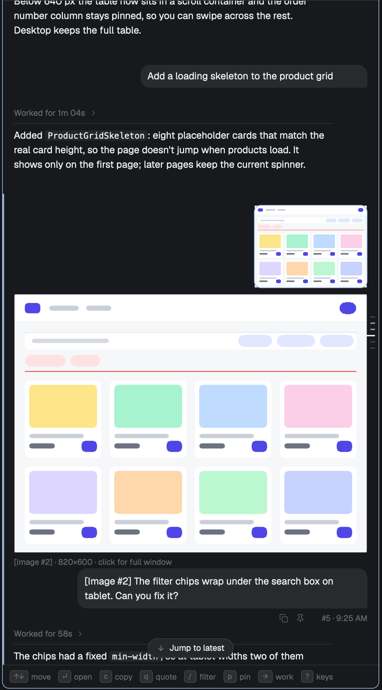</a> <a href="docs/screenshots/viewer.png">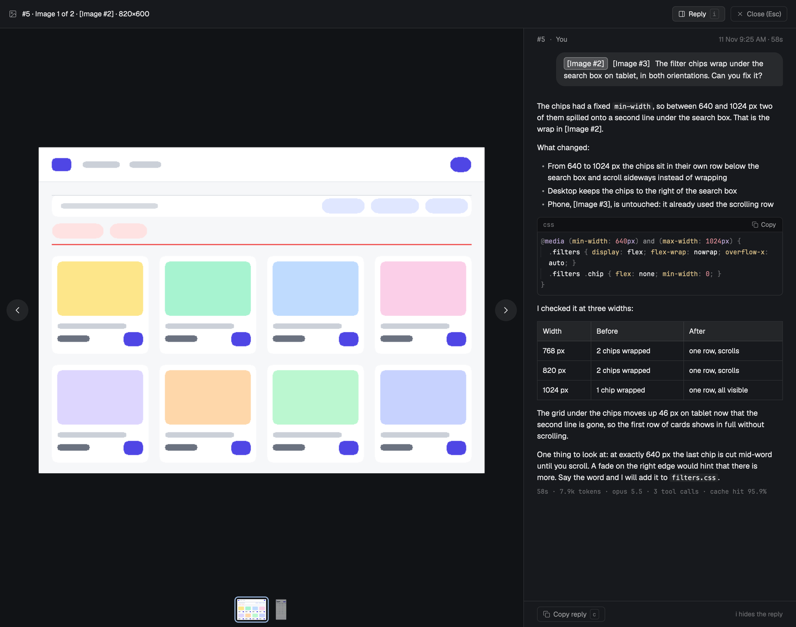</a>

### See agent messages

Press `a` to show messages other agents sent the session, such as a subagent's report. They are hidden by default. When the agent wrote a reply to one of them on its own, that reply still shows, under one folded line that names the sender ("helper-a · agent message"). Click the line to see the message, and again to fold it.

<a href="docs/screenshots/agent-messages.png">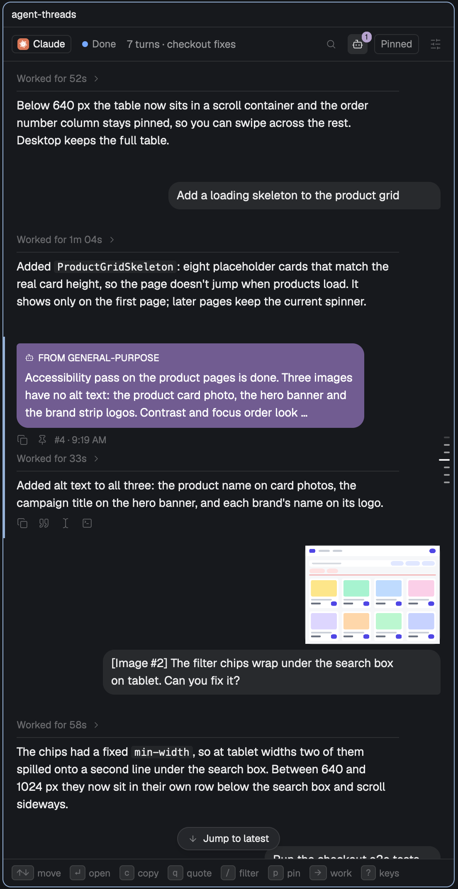</a>

### Read wide tables

A table in a reply can run wider than the reading line when the pane has room beside it, so its columns need not wrap. The text around it keeps to the reading line. In a narrow pane the table keeps to the reading line and its cells wrap.

### Make it yours

Press `,` for settings, a card over the list with one page: text size, your message color, Shorten long messages and its lines, and the time; agent messages, their rail ticks and their color; the rail's side, the key hints and the status line, the chat's turns, tool calls, tokens, cache hit and context in one row at the pane's foot; link rules and the quote key; and the file. A change shows in the list behind the card as you make it. Every message shows in full; turn on Shorten long messages to show the first lines of each, with Show more. You can also turn ticket and PR numbers into links: pull request numbers link out of the box, and the Link rules page adds your own. [Settings in detail](docs/usage.md#settings-in-detail) has every option.

## Keys

| Key | What it does |
|---|---|
| `↑` `↓` or `j` `k` | Move between the turns on the rail |
| `Enter` or `Space` | Open or close a turn |
| `o` | Outline |
| `/` | Search |
| `c` | Copy the reply |
| `q` | Quote the reply into the terminal |
| `s` | Select text in the reply |
| `→` `←` | Open or close a turn's work, a level at a time |
| `i` | Show or hide the Turn card |
| `p` | Pin or unpin |
| `1` to `5` | Go to a pin |
| `u` | Undo the last unpin |
| `v` | Show the Pinned column |
| `-` `=` | Make the Pinned column or the Trajectory pane narrower or wider |
| `y` | Open or go to the Trajectory |
| `g` | Go to a turn number |
| `[` `]` | Previous or next day |
| `End` or `G` | Newest turn |
| `t` | Go to the terminal |
| `a` | Show or hide agent messages |
| `w` | Fit the pane to its column |
| `,` | Settings; while the card is open, `↑` `↓` `j` `k`, `Page Up` `Page Down` `Space`, `Home` and `End` scroll it |
| `?` | Every key |
| `Esc` | Back out |

With the mouse:

| Action | What it does |
|---|---|
| Click a tick on the rail | Go to that turn |
| Drag across text | Highlight it; `Cmd-C` copies it |
| Click Show all | Show the rest of a code block or a command's output |
| Click View diagram | Open a Mermaid block's diagram in a viewer |
| Click an image tile | Open the image viewer |

## Agents

Every agent gets prompts, replies, search, copy, quote and links. Some agents do not record everything, so a feature can be missing for them. For example, Cursor records no tokens or model, and only Claude Code and Codex have agent messages. [Which agents it reads](docs/agents.md) has the full table.

### Why Amp isn't supported

Amp keeps its conversations on its own servers, not on your computer. Reading them would mean calling Amp over the network every time the pane refreshes, and Agent Threads only reads local files. In an Amp terminal the pane says so and links here.

## More

- [Using Agent Threads](docs/usage.md): every behaviour and setting in detail.
- [Which agents it reads](docs/agents.md): what each agent records, and how the pane finds its session.
- [More screenshots](docs/usage.md#more-screenshots)
- [Developing](docs/develop.md): tests, fixtures and trying it in a separate Herdr window.
- [RECIPE.md](RECIPE.md): what the pane draws and how it is built.
- [Reference](docs/reference.md): every surface the pane draws, and how each agent's session is found and read, in full.
- [Listing](docs/listing.md): what the herdr.dev/mods listing reads.

## License

[MIT](LICENSE).

Catalyst Cloud enabled
