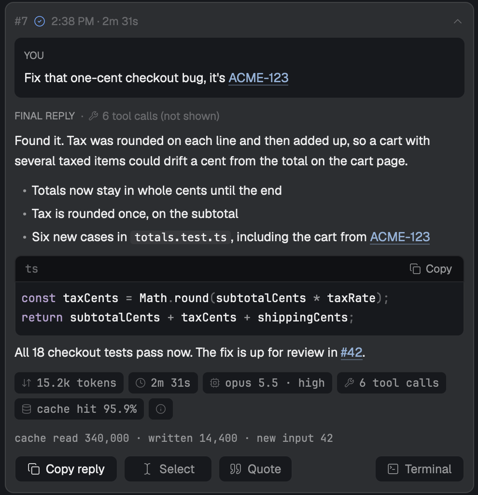
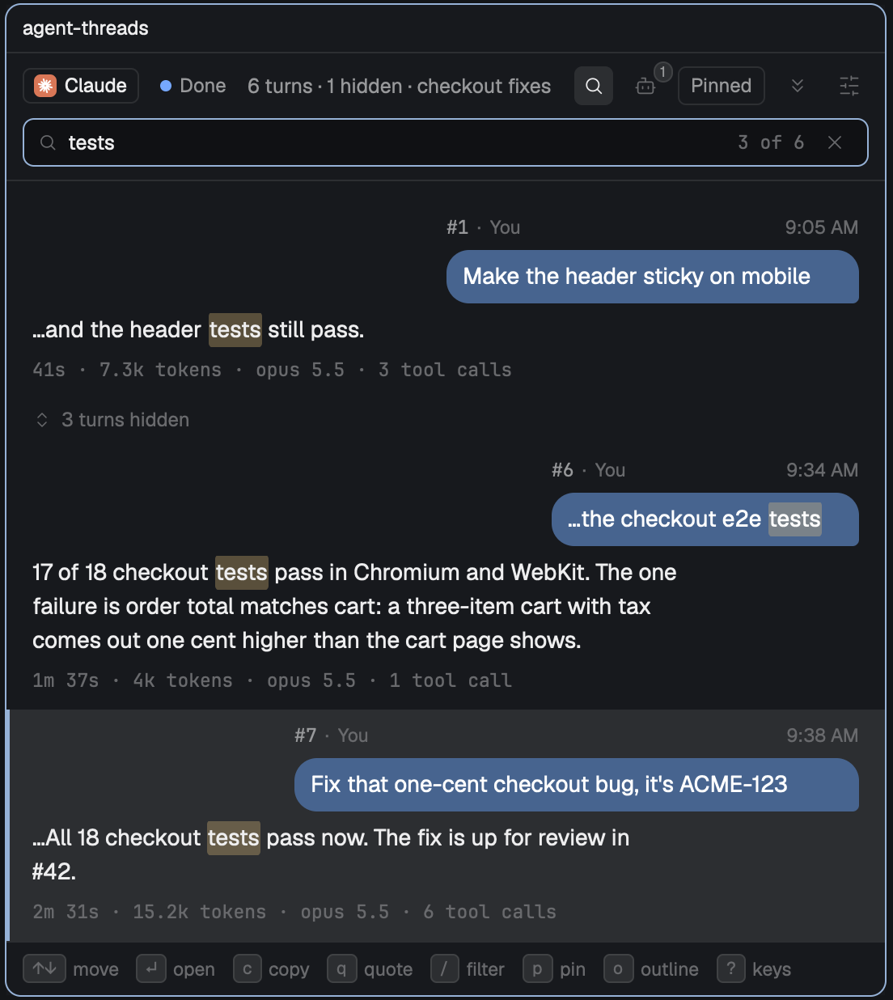
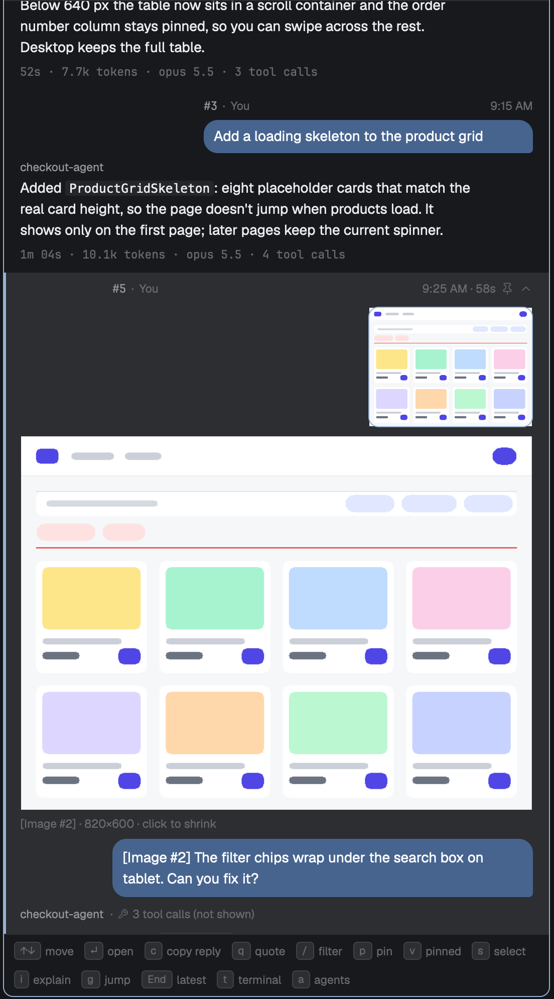
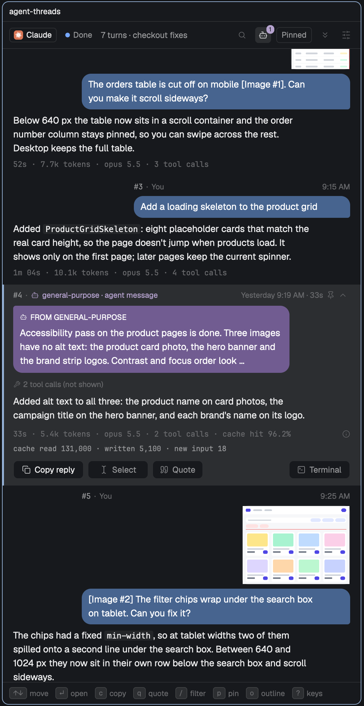
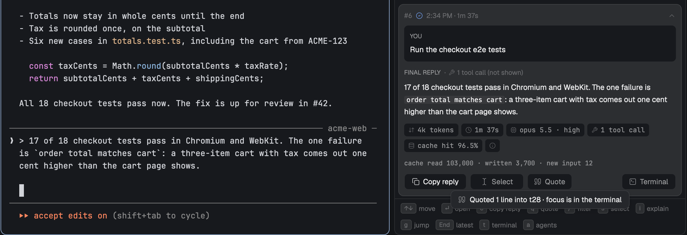
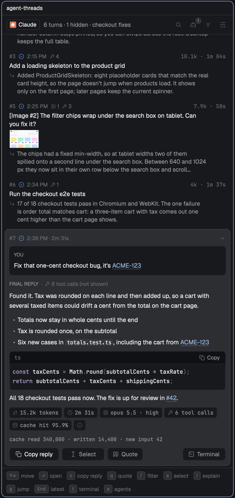
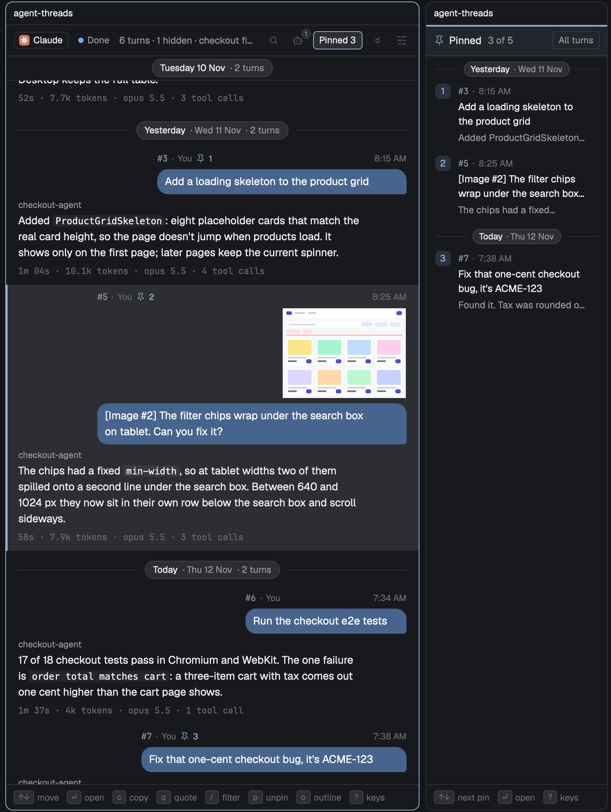

# Agent Threads

Long agent sessions are hard to look back through. The answer you got an hour ago sits under pages of tool calls, and finding it means scrolling. Agent Threads opens a pane beside your agent's terminal that shows only the conversation, as a chat: each prompt you sent in a bubble and the reply that came back under it, grouped by day. It works with Claude Code, Codex, OpenCode, Pi, Cursor and Antigravity.


## What you can do

- **Find an answer fast.** Scroll the list or press `/` to search. The list reads like a chat: your prompt sits in a slate-blue bubble on the right under "You", the start of the reply sits under it with the agent's name, the turn's number and time are above, and its tokens, time and model are below.
- **Read the whole reply.** Press `Enter` on a row to open it. Code, lists and quotes show as formatted Markdown, along with the turn's tokens, time and model. On Herdr 0.1.13 or newer you can drag across the formatted reply, press `Cmd-C`, then `q` to quote just that part.
- **Copy it.** `c` copies the reply. Each code block has its own copy button.
- **Quote it back.** `q` pastes the reply into your prompt as a `>` quote with a blank line under it, ready for your comment. To quote one part, press `s`, highlight the text, press `Cmd-C`, then `q`. Agent Threads never presses Enter for you.
- **Show or hide agent messages.** `a` shows or hides the messages other agents sent the session, such as a subagent's report or another session's message. OpenCode, Pi, Cursor and Antigravity have none, see [Which agents it reads](#which-agents-it-reads).
- **See the images you pasted.** They sit over your message as tiles, about a third of the bubble wide. In an open turn a click on a tile shows that image larger, under the tiles, and a click on the larger image opens all the message's images in a viewer that fills the Herdr window. While the agent is still working on that turn, a click on a tile opens the viewer.
- **Turn ticket and PR numbers into links.** Add a rule in settings, for example `ACME-123` to your tracker or `#456` to the repo's pull request.
- **Keep a few turns at hand.** `p` pins a turn, and your pins show in a Pinned column beside the list. See [Pins](#pins).
- **See background work after a turn.** When a background task wakes the agent after a turn has ended, the turn keeps its reply, and a line under it reads "Updating" with its clock, tool calls and what the agent said last.
- **Choose how much each row shows.** A row shows 4 lines of your prompt and 6 of the reply before "Show more". Settings change both.

## How it works

Press `Cmd-Shift-T` in a Claude Code, Codex, OpenCode, Pi, Cursor or Antigravity terminal. Agent Threads opens to its right, at the width of a reading line (545 px at the default text size), keeps to that width, and keeps up with that session as it runs. Press it again to move between the pane and the terminal. Every terminal can have its own Agent Threads pane, and each pane follows only its own session.

Agent Threads reads the agent's session on your computer. It sends nothing over the network, and it never types into your terminal except when you press `q` to quote.

## Which agents it reads

Tested on Claude Code 2.1.318, Codex CLI 0.160.0, OpenCode 1.19.5 and 2.2.5, Pi 1.5.0 (the terminal agent, not Pi Durable), the Cursor agent CLI 2026.11.05, and the Antigravity CLI (`agy`) 1.5.3. OpenCode 2.x moved its sessions to new tables, and the pane reads whichever the database has. None of these formats is a public promise, so a new version can change what the pane finds.

| | Claude Code | Codex | OpenCode | Pi | Cursor | Antigravity |
|---|---|---|---|---|---|---|
| Prompts, replies, search, copy, quote, links | Yes | Yes | Yes | Yes | Yes | Yes |
| Pasted images | Yes | Yes | Yes | Yes, while the temporary file Pi saved is on disk | No, the word `[Image]` shows in their place | No |
| Tokens, time, model, tool count, cache hit | Yes | Yes | Yes | Yes | Tool count, and the time of a turn the pane watched. No tokens, model or cache | Yes, with the model you chose in agy |
| Agent messages | Yes | Yes | No | No | No | No |
| Reads its session from | A JSONL file | A JSONL file | A SQLite database, read-only | A JSONL file | A JSONL file | A JSONL file |
| Finds the terminal's session by | The process's session record | The file the process has open | The terminal's title, then its folder | Its command line, then its folder | The chat the process has open, then its command line, then its folder | The conversation folder the process has open, then its command line |

Where an agent has no data, the pane leaves the feature out:

- **OpenCode has no agent messages.** Its subagents run as separate sessions, so nothing arrives in the session you are reading, and the agents button and `a` hint stay hidden.
- **Pi has no agent messages** either: it has no subagents of its own. Nor do Cursor's or Antigravity's records.
- **Pi pastes an image as a file path.** `Ctrl-V` in Pi saves the image to a temporary file and puts its path in your prompt. The pane shows `[Image #1]` in place of that path and the image as a thumbnail, after checking the file starts like a PNG, JPEG, GIF or WebP. It reads only files named `pi-clipboard-<id>` in the temp folder, the name Pi gives them. The pane keeps its own copy once shown. If macOS or a reboot clears the file before then, the open turn shows its path with "Image no longer on disk".
- **Cursor records no tokens, model or turn time.** The pane leaves out tokens, model and cache. A turn shows a time only when the pane watched it run, from when Cursor wrote the prompt (a few seconds after you sent it) to the turn's end. A turn read from the file later shows none. A prompt's clock time is Cursor's own, to the minute.
- **Cursor keeps no pasted image in its transcript.** It writes the word `[Image]` where the image was, and the pane shows that word.
- **Cursor joins thinking onto the reply.** Thinking it hides is the word `[REDACTED]` after the reply, and the pane drops it. Thinking it keeps has no mark that tells it apart from the reply, so the pane shows the reply as Cursor stored it. In testing, Composer's thinking was hidden and Grok 4.7 stored none.
- **A Codex, OpenCode or Pi turn with no usage on record**, such as one you stopped right away, shows no token count. Claude Code's cards still show theirs.
- **Antigravity keeps no pasted image the pane can read.** Its prompts show as text.
- **Codex, OpenCode, Pi, Cursor and Antigravity report no status to Herdr here**, so the pane looks for a new session every 3 seconds, and a quote pressed while they work has no "will queue it" message.

Some behaviour differs by agent:

- **OpenCode shares one database between terminals and records no process for a session.** The pane reads `OC | <title>` from the terminal. Otherwise it takes the folder's session whose turn began last since that OpenCode started, which is exact while one OpenCode runs in the folder. OpenCode 2.x's background `opencode serve` does not count as a second one. Until a session has a title, or when two sessions in the folder share one, a second OpenCode in the same folder makes the pane say "guessed" and offer **Choose**. Its guess can be the other terminal's session, so check it when that banner shows.
- **Quotes fold in OpenCode and Codex.** OpenCode shows a paste of three lines or more as `[Pasted ~N lines]`, and Codex shows a long one as `[Pasted Content N chars]`. The whole quote goes in when you submit. For OpenCode's folded paste the quote ends with one zero-width space, because OpenCode trims the blank line that keeps your reply out of the quote.
- **Pi records no process for a session either.** The pane takes `--session` from Pi's command line, else the session in the folder that Pi wrote last since it started. With two Pi terminals in one folder that is a guess with **Choose**, as for OpenCode.
- **Pi's `/tree` branches stay in the list.** Pi keeps a branch you left in the same file, and the pane reads the file in order, so both branches' turns show.
- **Cursor is found by the chat it has open.** Cursor keeps each chat's database open, and the file's path names the chat. The pane reads that path and never the database. A new chat (`/clear`) opens its database with its first prompt, so until then the pane stays on the chat before it. Without an open chat the pane takes `--resume <id>` from Cursor's command line, else the folder's newest chat since Cursor started.
- **Cursor sometimes writes its whole file again.** After `Esc`, for example, it writes the chat again from its own records, keeping only the last turn's end, and the pane reads the file again from the top. If you press `Esc` before Cursor has written your prompt, Cursor drops that prompt and marks the turn before it as stopped, so the pane shows that turn as stopped.
- **Antigravity is found by the conversation it has open.** `agy` keeps the conversation's folder open (`~/.gemini/antigravity-cli/brain/<id>`), and the pane reads `transcript_full.jsonl` in it, the copy that keeps long replies whole. A new conversation writes its file with the first prompt. Without an open folder the pane takes `--conversation <id>` from the command line. The model is the one agy records when you choose it, with its level, such as "Medium".
- **OpenCode's `/undo` shows late.** The pane keeps an undone turn until OpenCode deletes it, at your next prompt.

### Why Amp isn't supported

Amp keeps its conversations on its own servers, not on disk. Reading them would mean calling Amp over the network every time the pane refreshes, and Agent Threads only reads local files. In an Amp terminal the pane says so and links here.

## Screenshots

Select an image to open it full size. The session in these shots is made up.

To quote part of a reply on Herdr 0.1.13 or newer, open the turn, drag across the words you want in the formatted reply and press `Cmd-C`. The pane says how many words you copied, and `q` quotes only those. A drag can cross paragraphs, but not into a code block, which is a separate part of the turn. `s` selects across everything.

<table>
<tr>
<td width="50%" valign="top"><a href="docs/screenshots/open-turn.png"></a><br>An open turn: your prompt in its bubble, then the formatted reply under the agent's name, a copy button on the code block, ACME-123 and #42 as links, and the turn's tokens, time and model.</td>
<td width="50%" valign="top"><a href="docs/screenshots/search.png"></a><br>Typing "tests" after <code>/</code> narrows six turns to three.</td>
</tr>
<tr>
<td width="50%" valign="top"><a href="docs/screenshots/images.png"></a><br>A pasted image is a tile over your message. In an open turn a click on the tile shows it larger.</td>
<td width="50%" valign="top"><a href="docs/screenshots/agent-messages.png"></a><br>With agent messages on, a subagent's report is a plum bubble on the left, under its name.</td>
</tr>
<tr>
<td colspan="2" valign="top"><a href="docs/screenshots/quote.png"></a><br>After <code>q</code>, the prompt holds the reply as a <code>&gt;</code> quote, with the cursor under it.</td>
</tr>
<tr>
<td width="50%" valign="top"><a href="docs/screenshots/days.png"></a><br>A session that runs over several days gets a band for each day, with its turn count.</td>
<td width="50%" valign="top"><a href="docs/screenshots/agents.png"></a><br>The pane beside Codex, OpenCode, Pi, Cursor and Antigravity, each with its own mark, and beside Amp, which it does not read. Each shows what its agent records, so Cursor's turn has no tokens or model.</td>
</tr>
<tr>
<td width="50%" valign="top"><a href="docs/screenshots/panel.png"></a><br>The pane on its own, with the newest turn open.</td>
<td width="50%" valign="top"><a href="docs/screenshots/light.png"></a><br>The same session in Herdr's light theme.</td>
</tr>
<tr>
<td width="50%" valign="top"><a href="docs/screenshots/pinned.png"></a><br>Two pinned turns in the Pinned column beside the list. Each pinned turn shows its pin number in its header.</td>
<td width="50%" valign="top"><a href="docs/screenshots/updating.png"></a><br>A background task woke the agent after the last turn ended. The turn keeps its reply, and the Updating line shows the clock, tool calls and what the agent said last.</td>
</tr>
</table>

## Install

Needs the [Herdr](https://herdr.dev) app (built on 0.1.12), `jq`, and at least one of Claude Code, Codex, OpenCode, Pi, Cursor or Antigravity. Codex also needs `lsof`, OpenCode needs `sqlite3`, `pgrep` and `lsof`, and Pi, Cursor and Antigravity need `pgrep` and `lsof`. Besides those it runs its own `sh` scripts, `hc` and `git remote get-url origin` (for link rules).

```sh
git clone https://github.com/ryanrozich/herdr-agent-threads
cd herdr-agent-threads
./install.sh     # copies mods/agent-threads to ~/.config/herdr-app/mods/ and runs herdr-app check
```

Or copy `mods/agent-threads/` into `~/.config/herdr-app/mods/` yourself. Then merge [keys.json](keys.json) into `~/.config/herdr-app/keys.json` for the chord:

```json
{ "global": { "cmd-shift-t": "mod.open:agent-threads" } }
```

Without the chord, `herdr-app do mod.open --name agent-threads` opens it.

## Keys

| Key | What it does |
|---|---|
| `↑` `↓` or `j` `k` | Move between turns |
| `Enter`, `Space` or `o` | Open or close a turn |
| `c` | Copy the reply |
| `q` | Quote the reply into the terminal |
| `s` | Select view: the reply's exact Markdown source, to highlight, `Cmd-C`, then `q` |
| `/` | Search |
| `g` | Jump to a turn number |
| `End` or `G` | Newest turn |
| `[` `]` | Previous or next day |
| `t` | Focus the terminal |
| `a` | Show or hide agent messages |
| `i` | Explain the stats on an open turn |
| `p` | Pin or unpin the selected turn |
| `v` | Open or go to the Pinned column beside the list, or show the pins in the same pane when it is under 480 px wide |
| `1` to `5` | Return to that pin |
| `u` | Undo the last unpin |
| `w` | Fit Threads to the reading width (and the Pinned column to its width) |
| `,` | Settings |
| `Esc` | Back out: search, Select view, settings, the open turn |

## Pins

Partway through a long reply and a newer one needs you? Press `p`. The turn gets a pin and a number, and the text you are reading does not move. Press `1` to come back to the turn. It opens with the turn's number and your message at the top of the pane, the same first line as its row in the Pinned view. If you were reading further down, press `1` again: the turn opens at the start of that block of text, under a line that says the turn starts above. Click the line to see your message.

- Up to five pins. A sixth is refused: unpin one first.
- A pinned turn stays in its place in the list, with a pin icon and its number above the bubble.
- The Pinned column opens to the right of the list with only the pinned turns, in pin order. It opens by itself with your first pin, and when Threads opens on a session that has pins, as long as Threads is at least 480 px wide. It takes about a third of the Threads width, 240 to 320 px, and Herdr takes that room from the panes beside it, the terminal included. The keyboard stays in the list. If you close the column it stays closed until you press `v` or click **Pinned** again. Closing Threads closes the column too, and opening Threads again brings both back.
- In the column, `v` or **All turns** goes back to the list, `↑` `↓` move between pins, and `p` unpins. Under 480 px there is no room for the column, so the list itself shows the pins until you press `v` again, and a note says so.
- `p` again unpins. `u` undoes it, in the same place and with your reading place.
- The header's pin button and the pin on a turn's top line do the same with the mouse. The header's **Pinned 2** button (the count is your pins) opens or goes to the Pinned column.
- Search leaves the pins alone. Press `Enter` or click a result to give the keys back to the list, so `p` and the digits work with the search kept. Returning to a turn the search hides shows that one turn.
- Pins belong to one session and survive closing the pane, restarting Herdr and resuming. A forked session starts with none. A pinned turn that no longer exists shows in the Pinned view as "no longer in this session", and a click unpins it.

If your `quoteKey` is `p` or `u`, quote keeps the letter. The buttons still pin. `v` is taken, so a `quoteKey` of `v` falls back to `q` with a note in the settings panel.

Pins are saved in `~/.config/herdr-app/data/agent-threads/pins.json`: the session id, a fingerprint of the turn, your place and the first 80 characters of the prompt. Sessions untouched for 90 days are dropped. It stays on your machine, and you can delete it at any time.

## Settings

`,` opens the settings panel. It saves to `~/.config/herdr-app/data/agent-threads/settings.json`, which you can also edit by hand; open panes pick up a save within a second. A file saved by an older version with the old defaults, 2 and 3, reads as the new defaults, 4 and 6.

| Key | Default | What it sets |
|---|---|---|
| `textSize` | 14 | The size of message and reply text in px (12 to 18). Lines are 1.5 times the size apart and hold about 70 characters, however wide the pane |
| `promptLines` | 4 | Lines of your prompt a row shows (1 to 10) |
| `replyLines` | 6 | Lines of the reply a row shows (1 to 12) |
| `agentTurns` | false | Show agent messages |
| `readingWidth` | true | Keep Threads at the reading width: a wider pane is brought back to it |
| `bubbleColor` | `"slate"` | Your message bubbles: `slate`, `plum`, `blue`, `purple`, `teal`, `green`, `amber`, `rose`, `gray`, `plain` (the theme's own grey) or `"#rrggbb"` |
| `agentBubbleColor` | `"plum"` | Agent message bubbles, from the same choices |
| `youName` | `"You"` | The name over your messages, up to 40 characters. The settings panel has a field for it |
| `quoteKey` | `"q"` | The quote key: one lowercase letter the pane does not already use |
| `links` | none | Link rules, below |

### Link rules

A rule turns text that matches a pattern into a link in an open turn. No rules ship. For example:

```json
{
  "links": [
    { "name": "Issue", "pattern": "\\bACME-(\\d+)\\b", "url": "https://linear.app/acme/issue/ACME-$1" },
    { "name": "PR", "pattern": "(?<![\\w&/#])#(\\d{1,5})\\b", "url": "https://github.com/{repo}/pull/$1" }
  ]
}
```

- `pattern` is a JavaScript regular expression, JSON-escaped. `$0` in the URL is the whole match and `$1` to `$9` its groups.
- `{repo}` and `{owner}` come from the terminal folder's `git remote get-url origin`.
- Links skip code, existing links and URLs. A rule that is invalid or could be slow is dropped with a note in the settings panel.

[docs/usage.md](docs/usage.md) has the full rules, limits and every behaviour in detail.

## License

[MIT](LICENSE).

## More

- [RECIPE.md](RECIPE.md): what the pane draws and how it is built, the brief another agent can build it from.
- [docs/usage.md](docs/usage.md): every behaviour in detail.
- [docs/develop.md](docs/develop.md): tests, synthetic fixtures and trying it in a separate Herdr window.
- [docs/listing.md](docs/listing.md): what the herdr.dev/mods listing reads, and how to rename the mod.
