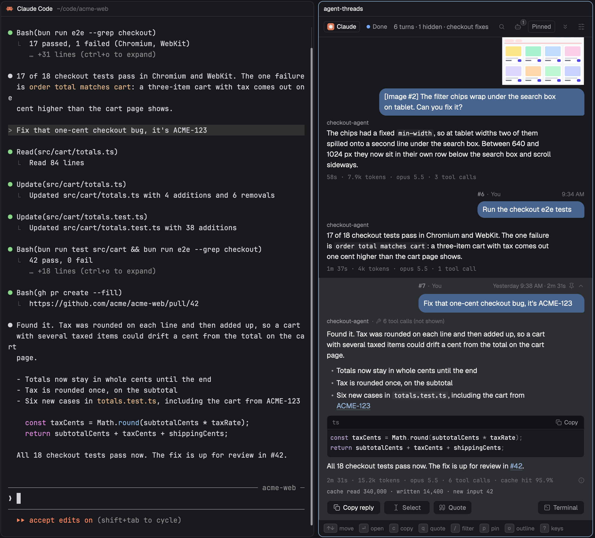
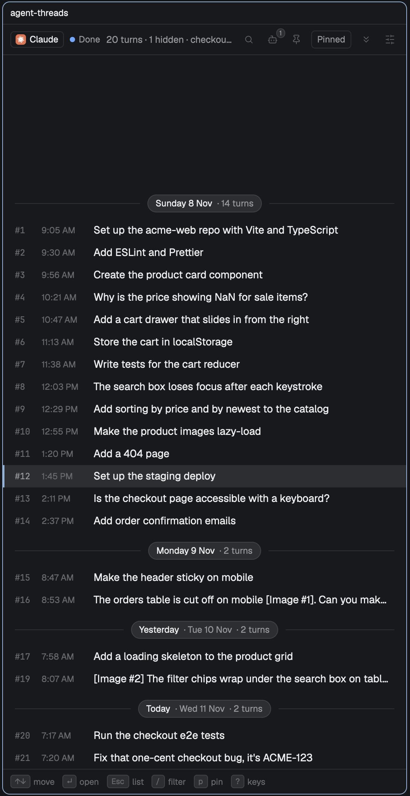
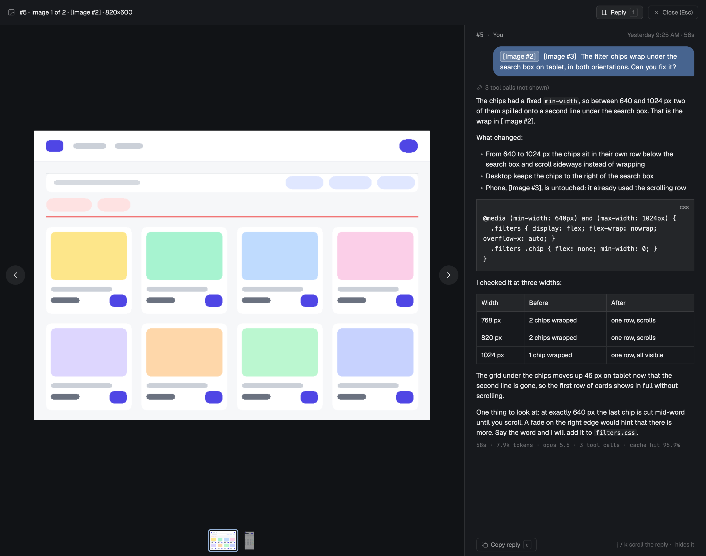

# Agent Threads

Long agent sessions are hard to look back through. The answer you got an hour ago sits under pages of tool calls. Agent Threads opens a pane beside your agent's terminal that shows only the conversation, as a chat: each prompt you sent in a bubble, the reply under it, grouped by day. It works with Claude Code, Codex, OpenCode, Pi, Cursor and Antigravity. It reads the session on your computer and sends nothing over the network.



## Install

You need the [Herdr](https://herdr.dev) app and `jq`.

```sh
git clone https://github.com/ryanrozich/herdr-agent-threads
cd herdr-agent-threads
./install.sh
```

Then add the chord to `~/.config/herdr-app/keys.json`:

```json
{ "global": { "cmd-shift-t": "mod.open:agent-threads" } }
```

Some agents need a few more command-line tools. [Install in detail](docs/usage.md#install-in-detail) lists them.

## Quick start

1. In a terminal running your agent, press `Cmd-Shift-T`. The pane opens to the right. Press it again to move between the pane and the terminal.
2. Move with `↑` `↓`. Press `Enter` to open a turn and read the whole reply. `Esc` closes it.
3. Press `/` and type to search.
4. Press `o` for the outline, one row per turn, to find an older turn fast.
5. Press `p` to pin a turn you want to come back to. `1` to `5` take you back.
6. Press `q` to quote the reply into your prompt, or `c` to copy it.
7. Press `?` to see every key.

## What you can do

### Read a long session as a chat

Your prompt is a bubble on the right. The reply starts right under it, and its time, tokens and model sit below. A band marks each day. Open a turn to see the whole reply, with code, lists and links formatted.

<a href="docs/screenshots/open-turn.png"></a>

### Find an answer

Press `/` and type. The list narrows to the turns that match. `g` jumps to a turn number, and `[` `]` move a day at a time.

<a href="docs/screenshots/search.png"></a>

### See the whole session at a glance

Press `o` for the outline. Each turn is one line, so a few days fit on one screen. `Enter` opens the turn in the list.

<a href="docs/screenshots/outline.png"></a>

### Pin the turns you need

Press `p` to pin a turn. Your pins show in a column beside the list, oldest first, numbered 1 to 5. Press a number to go back to that turn. `u` undoes an unpin.

<a href="docs/screenshots/pinned.png"></a>

### Quote a reply back to the agent

Press `q`. The reply goes into your prompt as a `>` quote, with a blank line under it for your comment. Agent Threads never presses Enter for you. To quote only part of a reply, select it, press `Cmd-C`, then `q`.

<a href="docs/screenshots/quote.png"></a>

### Know what the agent is doing

Beside the agent's badge, the header says Working, Needs you, Done or Exited. Click it to go to the terminal. Only Claude Code reports its state live; for the other agents the header shows only Done or Exited, and nothing while a turn runs. When something new arrives below where you are reading, the jump-to-latest button gets a dot.

<a href="docs/screenshots/panel.png"></a>

### Check a reply against its screenshots

Images you pasted show as tiles over your message. In an open turn, click one to see it larger, and click it again to open the image viewer. The viewer fills the window with the image and puts your prompt and the reply beside it, so you can read the reply against each screenshot. `←` `→` step through the images, `j` `k` scroll the reply, `i` hides it and `Esc` closes the viewer.

<a href="docs/screenshots/images.png"></a> <a href="docs/screenshots/viewer.png"></a>

### See agent messages

Press `a` to show messages other agents sent the session, such as a subagent's report.

<a href="docs/screenshots/agent-messages.png"></a>

### Make it yours

Press `,` for settings: text size, how many lines a row shows, bubble colours, your name, and whether agent messages show. You can also turn ticket and PR numbers into links. [Settings in detail](docs/usage.md#settings-in-detail) has every option.

## Keys

| Key | What it does |
|---|---|
| `↑` `↓` or `j` `k` | Move between turns |
| `Enter` or `Space` | Open or close a turn |
| `o` | Outline |
| `/` | Search |
| `c` | Copy the reply |
| `q` | Quote the reply into the terminal |
| `s` | Select text in the reply |
| `p` | Pin or unpin |
| `1` to `5` | Go to a pin |
| `v` | Show the Pinned column |
| `g` | Go to a turn number |
| `End` or `G` | Newest turn |
| `t` | Go to the terminal |
| `a` | Show or hide agent messages |
| `,` | Settings |
| `?` | Every key |
| `Esc` | Back out |

## Agents

Every agent gets prompts, replies, search, copy, quote and links. Some agents do not record everything, so a feature can be missing for them. For example, Cursor records no tokens or model, and only Claude Code and Codex have agent messages. [Which agents it reads](docs/agents.md) has the full table.

### Why Amp isn't supported

Amp keeps its conversations on its own servers, not on your computer. Reading them would mean calling Amp over the network every time the pane refreshes, and Agent Threads only reads local files. In an Amp terminal the pane says so and links here.

## More

- [Using Agent Threads](docs/usage.md): every behaviour and setting in detail.
- [Which agents it reads](docs/agents.md): what each agent records, and how the pane finds its session.
- [More screenshots](docs/usage.md#more-screenshots)
- [Developing](docs/develop.md): tests, fixtures and trying it in a separate Herdr window.
- [RECIPE.md](RECIPE.md): what the pane draws and how it is built.
- [Listing](docs/listing.md): what the herdr.dev/mods listing reads.

## License

[MIT](LICENSE).
