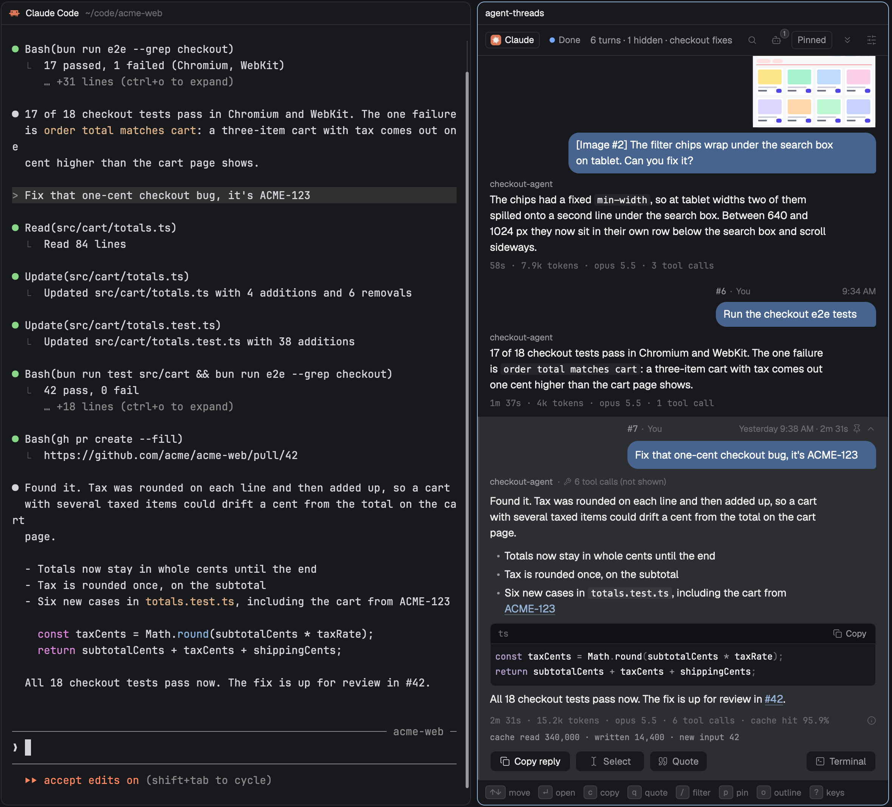

# Agent Threads

Agent Threads opens a pane beside your agent's terminal that shows the session as a chat: each prompt you sent in a bubble, and the reply under it, about 70 characters a line, so you can find an earlier answer without scrolling back through the session. You can search, copy a reply, quote it into your next prompt, pin turns to a column beside the list and see the images you pasted. It works with Claude Code, Codex, OpenCode, Pi, Cursor and Antigravity.

## What you see

- **Header** (40 px, `border` line below): a Claude badge (the Claude mark on a 14 px `#d97757` tile, then "Claude" in 12 px from 300 px; for another agent a neutral chip with its name and "Not readable", for a remote terminal a chip with the machine name and "Not read yet"). The badge's tooltip names the binding: "Reading t4 · session 7f3a1b2c · 1.2M tokens · cache 97.1% (read … · written … · new input …) · turn #14: cache 95.9% (read … · written … · new input …)", the last part for the selected turn, so a pane bound to the wrong terminal or session shows without a click. Then "N turns · M hidden · <session title>" in `muted` 12.5 px (N counts the turns shown; "· M hidden" counts the agent messages hidden in the whole list, every session, the same number as the Agents button's corner count and tooltip, and shows from 300 px; "· guessed" when the session was guessed from the folder, "Reading… 42%" while a transcript is read, "No session" when none was found). Right side, 24 px icon buttons, `dim` at rest, `hover` background: Filter (`/`), Agents (a bot icon, `a`; only when the session has agent messages or the setting is on, and from 300 px; tooltip "Show agent messages (12 hidden)" or "Hide agent messages"; a corner count shows how many are hidden, or shown when on), Pin (`p`, from 300 px, only in the Pinned view: the list's header leaves pinning to `p` and an open turn's pin, so the text keeps that room), then a labelled button, "Pinned 2" (the pin count; 12 px `muted` text in a 24 px `border` box, `accent` border and `raised` fill while the Pinned column is open or the pane shows the Pinned view, when it reads "All turns"), Jump to latest (End, from 440 px), Settings (sliders icon, `,`). From 440 px the agent's state follows the badge: a 7 px dot in the state's colour and its word in 12 px, in a 24 px box with 5 px padding a side and the `hover` fill on hover, a pointer cursor and a click that focuses the terminal as `t` does (its tooltip ends "click to go to the terminal (t)"). Under 440 px the badge drops its word and the state becomes an 8 px dot on the badge's corner; the badge then takes the click, the same `hover` fill and the tooltip's click line, since the dot is too small to aim at. `headerButtonWidth` in `ui.js` sizes the buttons for `headerLayout`. The Pinned view's header leads with a 14 px `accent` pin and "Pinned" in 13.5 px semibold `foreground`, then (in the same pane only) the badge, then "2 of 5" in `muted`. It has a 2 px `accent` bar along its top and `accent` at 8% behind it, so the column reads as its own view beside the list. Herdr titles every copy of a mod's pane with the mod's name and gives a mod no way to rename its pane, so the heading carries the name. The Pinned pane's header has no badge, then the pin button (from 300 px) and "All turns".
- **Settings panel** (`,` or the sliders button; Esc closes it), under the header where the filter field goes: an Agent messages switch, Prompt lines [−] 4 [+] and Reply lines [−] 6 [+], "Collapsed rows only. Changes apply now.", Text size [−] 14 [+] (12 to 18), the settings file's path with Copy path, and Reset to defaults (14 px, 4 / 6, slate and plum, You); a Your name field (an Input; `naming` while it has the keyboard, when keys type and Esc or Enter gives them back). Between them, a row of 22 px swatches for Your messages and one for Agent messages (`ui.js` BUBBLES, plus the file's own `#rrggbb` when it holds one), the chosen one ringed in `accent` and named on the right ("Blue · default"). Inside a coloured bubble the text is drawn with a theme whose text, muted, dim and accent colours are the bubble's ink (white or `#111111`, whichever reads better on the fill, `ui.js` bubbleInk), so quotes, a command's name and Show more read on it. TextView draws Markdown in the theme's text colour whatever its parent sets, so on a coloured bubble the open turn's message is plain text with quotes behind their bar. Under them, "Link rules · 3 (1 not valid) · Quote key · q", and up to 4 notes for rules or a quote key the file holds but Threads cannot use ("Link rule 3: nested quantifier, as in (a+)+"). A settings file that is not valid JSON shows one line saying the defaults apply.
- **Filter field** (shown while filtering): 30 px, `chrome` fill, `accent` border while typing, placeholder "Filter turns, or #12 to jump", a `/` key chip while empty, then "3 of 41" (matching turns across every session in the pane) and a clear (×) button. "#12" in the field does not filter: it selects turn 12 (of the newest session that has one) and scrolls to it, the counter says "turn 12" or "no turn 12", and Enter keeps the turn selected and closes the field. Matches are marked with a `working` tint in row previews and in the open turn's message.
- **Banners** under the header when they apply. Neutral blocks (`chrome` fill, `border` line): "Session ended · claude exited at 2:31 PM" or "Session ended · t4 closed at 2:31 PM", with "The N turns read so far stay here…" and Close pane; "t4 moved to tab "x"" with Terminal and Close. Tinted cards (the colour at 12%, border at 33%): Guessed session (`working`, with "Choose from N…" when there are several candidates), Could not read the transcript (`blocked`), Transcript not found (`blocked`: the file was deleted or moved; the turns read so far stay, and the banner goes when the file comes back).
- **Width**: `Cmd-Shift-T` opens a pane at `fitWidth(textSize)` in `ui.js`, the reading line plus 16 px each side plus 52 px (545 px at 14 px): the launcher marks the new pane in `shared("threads.fit")`, and the pane, once it has measured itself and read the settings, runs `layout.resize` to that width if it is wider, and clears the mark. A pane wider than `fitWidth` lays the turns out in a centred column that wide (`this.width` is the column, `pw()` the pane); the header, the Pinned column's width and the footer go by the pane, and presses on the list are read in the column's px (`colLeft()`).
- **Collapsed reply**: `mdPreview` in `ui.js` takes whole source lines of the reply that fit Reply lines at the reading width (a blank line counts half, a code line one; a paragraph longer than what is left is cut at a word with " …"; a cut fence is closed), and the row draws it with TextView Markdown at the reading size, not selectable and with no link rules. Its height is measured in the probe as a part of its own (`cmd:<turn key>`); the row's height is the rest of the row (`mdBase`, image tiles included) plus that measure, and until then `mdEst`. While a search is on, the row keeps the flattened text around the match.
- **Day bands** (`dayItem`): 46 px, lines in `border` either side of a 24 px pill filled with `bandFill` (kept per theme), the day in `foreground` 12 px semibold, the date and count in `muted`. **Sticky day**: `stickyDay()` finds the day band above the list item at the top of the pane (`topKey`, set while the list draws) and the body draws the same pill 6 px from the top, over the list; not when a band, or the item right before one, is at the top. The drawing pass may not redraw, so a change sets `stickyDue` and a 120 ms timer redraws.
- **Turn list**, oldest at the top, newest at the bottom, opened scrolled to the newest turn. A short list sits at the bottom of the pane, by the newest turn. Each row is one exchange, drawn like a chat, 16 px in from each side with 8 px above and 10 px below. A meta line in 11.5 px `dim`: "#n" in the mono font in `muted`, "·", the sender (your name, `youName`, default "You", in semibold `dim`; an agent's icon and name in the sender colour), a stop or error icon when the turn was interrupted or failed, a pin and the pin number in `accent` when pinned, a bell and the number of background updates ("99+" above 99), then the time as "9:05 AM" at the line's right end. On your own messages the line spans your bubble, from its left edge to its right (`headerFit`: a bubble too short for all of it drops the name first, and the line is never narrower than the number, icons and time); on an agent's it spans the text width from the left. Then the prompt in a bubble on the right: pasted images as tiles over the bubble on the right (`ui.js` tileRow: `thumbSize` high, a third of `bubbleMax` less 4, 56 to 120 px; 0.75 to 1.5 times that wide by the image's shape; 6 px apart; radius 10; "+N" for the rest), then the prompt in a bubble on the right: `bubbleColor` (default slate `#47648F`; `plain` is 8% `foreground` over whatever is under it), radius 14 with a 4 px bottom-right corner, 10 px by 6 px padding, as wide as its widest line and at most 82% of the text width (90% under 320 px), and its text never wider than a reading line (`MEASURE` 70 characters of `PROSE_EM` 0.47 em: 461 px at 14 px). Inside it the prompt, up to **Prompt lines** (default 4) wrapped lines at the reading size in medium `foreground` (`ui.js` readType: **Text size**, default 14 px, on lines 1.5 times that, 21 px; an agent's message half a px smaller), and "Show more" with a chevron in `accent` when text was left out. Under the bubble, with no name over it, the reply as plain text, at most a reading line wide (`ui.js` readWidth) (Markdown flattened: no emphasis, code or heading marks, list items joined with " · ", code blocks as "[code]", link text kept), up to **Reply lines** (default 6) reading lines in `foreground`, then "Show more" when cut. Last, one 16 px stats line in 11.5 px mono `dim`: "52s · 7.7k tokens · opus 5.5 · 3 tool calls" ("52s · 7.7k · 3 tools" under 300 px). The last line of a cut text ends in "…"; newlines in a prompt become spaces. A prompt that quotes Markdown (`>` lines, nested ones flattened; `>` inside a code fence is code) shows the quote as one line with a 2 px bar, 10 px inset, half a px under the reading size in `muted`, counted within Prompt lines, and the first line of the comment under it; a prompt that is only a quote fills Prompt lines with it in the prompt style. Link rules never apply in rows. Rows are as tall as their parts (`ui.js` rowHeight: 8 + 16 + 6 + 12 + a reading line (21) per prompt line + 6 + a reading line per reply line + 6 + 16 + 10, and 18 for each "Show more", and the tile height + 6 when the prompt has images). Interrupted rows say "No reply · interrupted after N tool calls" in the ban colour. The selected row has the `selected` fill and a 2 px bar on its left, `accent` while the pane has the keyboard and `border` otherwise. When a session spans several days, a day starts with a centred line: the day in 11.5 px semibold `muted` ("Today", "Yesterday", else "Monday 2 Nov"), the date for today and yesterday and the day's shown turns in `dim` ("· Sat 7 Nov · 2 turns"), between two 1 px `border` hairlines, 46 px tall in all. A search shows no day lines.
- **Command rows**: a slash command that Claude worked on (a skill or custom command) shows its name in 12.5 px mono, regular weight, `muted`, with no fill and no hue ("/review-pr", long names cut in the middle, at most 45% of the row), then its arguments in 13 px `foreground`, wrapping to the right of the name. The leading "/" and the mono face mark it. A command with no arguments draws its name in `foreground`. Where `muted` reads under 4.5:1 on the row's own background (the `selected` row in every bundled theme), the name is `foreground`; the debug report lists both per theme. A filter hit keeps its `working` tint. A command line with no command name (another build's shape) never shows its tags; its text is the prompt.
- **Agent messages** (hidden by default): turns another agent sent, an hc report or request (`<hc from="t7 review">`), a peer session's message (`<teammate-message teammate_id="…">` or `<agent-message from="…">`), a scheduled prompt or the SDK. Shown, an agent message's bubble is on the left, `agentBubbleColor` (default purple `#7C3AED`; `plain` is outlined: `background` fill, 1 px `border`), radius 14 with a 4 px top-left corner, and its meta line, on the left, starts with a kind icon (bot; clock for a schedule; terminal for the SDK) and the sender in 11.5 px semibold `ansi5` ("t7 review" below 300 px, "t7 review · hc report" from 300 px, "helper-a · agent message", "Agent message" when no name is given, "Scheduled", "SDK"), cut in the middle and at most 60% of the line, and never wider than the room the icon, time, "#n" and the bell and tool counts leave (so a long name shortens instead of pushing the time or "#n" past the gutter), then the time and "#n". An agent turn with no text (a task notification that opens a session) reads "(no message text)" under its label. The prompt is 12.5 px `muted`. Where `ansi5` is under 4.5:1 on the background, the label mixes `ansi5` toward the foreground (the debug report lists the contrast for every theme). Numbers count every turn, so hidden ones leave gaps; the newest turn shows while it is live whoever sent it, and when a hidden one finishes, a selection on it moves to the newest shown turn (or the one before it when not following), so Enter and `c` never act on a turn the list does not show. When Claude answers the person's prompt and an agent message in one reply, the reply lands on the agent turn; while agent messages are hidden the person's row shows, opens and copies that reply, and its caption adds "shared with agent message #N from <name>". A slash command line keeps its origin: one a peer, a schedule or the SDK sent is their turn and hides with them. With every turn hidden, the list says "Nothing you typed in this session yet. N agent messages are hidden." with Show them. Task notifications and auto-continuations are not agent messages: they stay folded into the turn above as background updates.
- **Open turn**: the exchange opens in place, with no card around it. Each of its list items is 16 px in from each side like a closed row, and a selected turn's items all carry the `selected` fill and the 2 px bar, so they read as one exchange. The top line is the turn header: "#7 · You" (the number in `muted`, a step above the name), then "Sat 8:43 AM · 2m 31s" (a day prefix for other days) at its right end, then a pin (`accent` when pinned) and a collapse chevron; a click on the pin pins (`ui.js` headPinHit). Over the person's own message it spans their bubble, from its left edge to its right (`headerFit`; the name drops first when the bubble is too short, and the line never goes under the number, icons and time); over an agent's it starts at the reply's left edge. Then the message in its bubble, as on a closed row but 8 px tall padding and as wide as its widest line (the prompt as Markdown, with its quotes as blockquotes, up to 2 lines per quote, 3 lines of comment and at most 600 characters, then "+ N more lines · Show all"; while a filter matches the prompt it is plain text with the matches marked; Show all shows the prompt to its end, up to 200,000 characters, then "… N more characters not shown"; the whole prompt scrolls inside the block past 420 px, and a shorter one is drawn at its own height; "Show less" folds it again; a command's chip sits on its own line in the bubble, and an agent message's outlined bubble on the left starts with its sender in the sender colour). Pasted images come before the message: an `imgs` part with the tiles as on a closed row (8 px above), and under it each image a click on its tile opened (`img` part, `full` set `i:<turn>:<n>`; a list item takes one click handler, so `tileAt` finds the tile from the press position: the tiles end 16 px from the right edge): 8 px above, the image at the pane's text width or its own size if smaller, at most 1,600 px tall, `border` stroke and radius 6 on `background`, then an 18 px `dim` caption "[Image #2] · 300×600 · click to shrink"; "Loading image…" until it is decoded. The tile of an open image has an `accent` ring. After the message, a caption line with what the reply leaves out, "🔧 N tool calls (not shown) · 🔔 M background updates" (wraps when narrow; 8 px of space when there is nothing to say), led by the agent's name in semibold `muted` only in a session where more than one agent replied (`mixedAgents`: OpenCode's build and plan), the reply as Markdown at the reading size and line (its box sets `text_size` and `line_height`, and TextView takes both: 21 px measured at 14 px), at most a reading line wide (`prose()`), at its own height, with no scroll inside the card (selectable from Herdr 0.1.13, which draws the selection behind the text; before that not selectable, and the first click says to press s). After a press in the list the clipboard is noted; when ⌘ is released and the clipboard holds new text from an open reply, a toast says q quotes it, and q quotes that text instead of the whole reply while the clipboard still holds it. Select below shows the exact Markdown source, with the link rules applied to its prose (never in code: fenced, also in a quote or a list item; indented; or an inline span, also one over a line break), each code block as a read-only editor with its fence's language (no label when it names none) and its own Copy button. The editor wraps long lines (`soft_wrap`: the editor keeps its cursor at the end of the text and has no way to move it, so a block that could scroll sideways could sit scrolled away from the start of its lines), and the box is as tall as its wrapped rows (`ui.js` codeRows, 7.3 px a character at 12 px), 12 rows at most, scrolling inside past that with "N rows · scrolls inside" under it, "Show full reply · N words" for long replies and "Show less" after. When a background update after the reply said something new, "LATEST UPDATE · after M background updates" follows with that text flattened into one block that wraps at the text width, showing up to 6 whole reading lines, and Show all when it is longer (the whole text as Markdown). Then the stats on one 11.5 px mono `dim` line, as on a closed row with "cache hit 99.6%" and "context compacted" (when the context was compacted during the turn) added, an info icon at its right, and the raw counts under it ("cache read 1,204,331 · written 31,008 · new input 4,112", 11 px mono on 16 px lines). `i` or a click on the stats adds a **legend** under them for every open turn (it lasts for the pane's session): one 11.5 px `muted` sentence per figure the turn shows, with its icon, "context compacted" first, then the counts line. Sections are separated by spacing only: 6 px within a section, 10 px between sections, 14 px before LATEST UPDATE. LATEST UPDATE and the counts line are `muted` (`foreground` where `muted` reads under 4.5:1); `dim` is for dividers, separators and icons. Then an action bar: Copy reply, **Select** (text-cursor icon), **Quote** (quote icon) on the left, **Terminal** (square-terminal icon) on the right; Quote and Terminal only when a pane shows the terminal. Labels drop as the pane narrows, in this order: Quote's, Select's, then "Copy reply" becomes "Copy", then Terminal's (at 380 px: Copy reply, Select, the Quote icon, Terminal; at 240 px: Copy and three icons). A press between buttons does nothing. **Select view** (`s` or Select) swaps the reply for its Markdown source in a read-only editor with a 1 px `accent` border and the hint "Select text, ⌘C, then q quotes it · s or Esc returns" ("⌘C, then q quotes it · s returns" below 300 px); `⌘C` copies the selected source, and a toast "Copied 3 words · q quotes them" follows when what it copied is from this reply. `q` (or Quote) there quotes what ⌘C copied. A mod cannot read the editor's selection or make it copy: `EditorState` has no selection, and `window.dispatch_action` and `cx.bind_keys` reach only the shell's own named actions (`gpui_shell::ShellAction`), never the editor's `input::Copy` (tried on a drawn window: the editor held the keyboard, the action went out, nothing was highlighted or copied). When the clipboard holds nothing from this reply (nothing copied, or text from another window), `q` pastes nothing and toasts "Couldn't read the highlight, press ⌘C then q"; it never quotes the whole reply from Select view. Each press is recorded, without its text, in `shared("threads.lastQuote")` on every build (source, gate, why, lines, chars, pasted, toast), and in the debug report's `lastQuote`. The first click on a formatted reply shows "Press s to select text in this reply" once per pane. Code editors are made when a turn opens and made again when a block's text changes (a running turn that finishes while open, a replaced file).
- **Running turn**: while Claude works, the newest turn is an exchange with a spinner and "now" in its meta line, the prompt in its bubble, then where the reply will be: "Working · 0:48 · 3 tool calls so far" in `working`, and a stats line "5.6k tokens · no reply yet". Selected, it shows the prompt in full (up to 6 lines), the live state with its clock, tool calls and tokens so far, and a note: "No final reply yet. It appears here when Claude finishes this turn." The clock ticks every second. It says "Needs you" in `blocked` when Claude waits for you, and "No reply yet" with a clock icon in `dim` when the agent stopped without a reply ("This turn has no final reply yet. It may have been stopped."). Task notifications that make Claude work after a finished turn show the same running state.
- **Dividers**: "New session · /clear at 2:31 PM" with the eraser icon and a rule to the right when the terminal moves on to a transcript that starts with `/clear` (the time is that line's), "New session · 2:35 PM" otherwise. Header counts follow the newest session.
- **Footer** key hints: ↑↓ move, ↵ open, c copy reply, q quote (from 300 px, when a local terminal can take a quote; the key from `quoteKey`), s select and i explain (with a turn open, from 300 px), / filter, p pin or unpin, o outline (the first to give way), v pinned; from 300 px also g jump, End latest, t terminal, a agents (when the session has agent messages) and "[ ] day" when the turns span more than one day. In Select view: drag select · ⌘C copy · q quote · Esc back (⌘C copy · q quote · Esc back below 300 px). In the outline: ↑↓ move · ↵ open · Esc list · / filter · p pin, then ? keys. In the Pinned view: ↑↓ next pin · ↵ open · p unpin, then from 300 px 1-5 go to pin · u undo · c copy reply · q quote · v all turns ("v back to all" in the Pinned pane) · t terminal.
- **Toasts**: "Reply copied · 412 chars, Markdown" or "Code copied · 12 lines" (the button turns `ansi2` and says Copied), "Couldn't copy" (`circle-x`) when the clipboard write fails, "Focused t4 · Claude Code" or "Focused t4 · moved to tab "x"" or "t4 is closed", "Agent messages shown" / "hidden", and the quote toasts: "Quoted 4 lines into t4", "Quoted your selection into t4", "Quoted the first 40 lines into t4", "Quoted the start into t4 · cut at 2,000 characters" (a line over the cap is cut at a word, ending in "…"), "Quoted into t4 · Claude will queue it", with " · ⌘V again shows it in full" when Claude will fold the paste and " · focus is in the terminal" the first time; refusals leave the quote on the clipboard: "t4 is at a shell. Quote copied.", "t4 is not running claude. Quote copied.", "Claude is waiting on a prompt in t4. Quote copied.", "claude exited in t4. Quote copied.", "t4 is in another tab. Quote copied.", "No terminal for this pane. Quote copied.", "Remote terminal. Quote copied.", "t4 is closed. Quote copied.", and "Could not focus t4. Quote copied.". With the settings panel or the session picker open, the quote key does nothing. Toasts show in a `popover` pill above the footer for 2 s; a quote's for 2.5 s, and a refusal's or a busy quote's for 3 s.
- **Times** are 12-hour with AM/PM everywhere (rows, card head, banners, the New session divider, the session picker): "9:05 AM", "12:00 PM", with a no-break space so "AM" never wraps away.
- **Cache hit %** is the share of the turn's prompt tokens read from cache, floored to one decimal: "cache hit 99.6%", "82%", "0%". It shows 100% only when nothing was written to cache and there was no new input. The tokens chip counts new input, cache writes and output, not cache reads, so it is usually far smaller than the cache read count.
- **Other states**: Finding the session (skeleton), Reading session (180 MB)… with a percentage bar (indeterminate until the first 2 MiB step is in, so it never says 0%; turns appear while it reads), Couldn't read this session (the error, Retry and Close pane; the header says "Read failed"; with turns already read, the "Could not read the transcript" banner has Retry instead), No turns yet, No turns in this session yet (after `/clear`), No session found (a file-search icon on a raised tile, what was tried, each step ticked or crossed, Retry, Choose from N…, Close pane, and the note "Starting claude with --resume, or upgrading Claude Code, makes the match exact."), Choose the session (newest first, with time and size), Remote sessions aren't read yet, <Program> isn't supported yet, Terminal closed.

No cost is shown. The agents' session records hold no per-turn cost that Threads shows, and Threads does not estimate one.

## How it behaves

- It is read-only toward the agent, with one exception. It never types, sends keys or submits anything to a terminal. The exception is the quote (`q`, the Quote button): `quoteToTerminal()` puts the quote on the clipboard, runs `pane.focus {pane}`, checks `focused().terminal` (up to 3 retries 40 ms apart) and runs `terminal.paste` (Herdr's ⌘V), which the agent receives as one bracketed paste. No Enter or other key follows, and the text is cleaned first (control characters, CR, stray paste markers). It pastes only into a local, open terminal shown in a pane, running `claude`, `codex` or `opencode`, and not waiting on a permission prompt (`hc get <t> --json` at the press); otherwise the quote is only copied. The other commands it runs are `pane.split` (to open itself), `pane.focus` (Terminal, and to go to an open Threads pane) and `pane.close` (Close pane). The only file it writes is its own settings file. `test/readonly.test.js` fails the build if any of this changes: `terminal.paste` may appear once, in `quoteToTerminal()`, with no send, keys, Enter or newline there, there is no quote command (only the debug-only `debugQuote`), and `exec` runs only `sh` and `git -C <folder> remote get-url origin`.
- **Open it** with `cmd-shift-t` (the suggested chord: `"cmd-shift-t": "mod.open:agent-threads"` in `keys.json` → `global`) or `herdr-app do mod.open --name agent-threads`, with the agent's terminal focused. It splits a Threads pane to the right of that terminal. Pressing it again focuses the open Threads pane for that terminal instead of opening a second, and pressing it on a Threads pane goes back to its terminal.
- The pane opens at half width; drag the divider once.
- **Finding the session**: `hc get <terminal> --json` → `foreground.pid` → `~/.claude/sessions/<pid>.json` → `sessionId` (tried whenever the program is `claude` or the pane reports `claude-code`, so wrappers work); else `--resume`/`-r`/`--session-id` in the foreground argv (not with `--fork-session`, which writes a new id); then `~/.claude/projects/*/<id>.jsonl`. Ids are checked against the 36-character uuid form. If the record names an id whose file is not written yet, the pane keeps what it shows and adopts the file when it appears. Failing those, the transcripts in the folder's project directory (every character but letters and digits becomes `-`; the process's real path, `/private/tmp/x` on macOS, and the terminal's path are both tried, then a scan for a folder whose newest transcript ran in that folder), minus the ones another live claude records, newest first: the newest is shown, marked as a guess, with "Choose from N…" when there are several. A picked transcript pins the pane.
- **Session changes while reading**: a read in flight stops when the pane moves on to another session (after `/clear`, or a pick), and the new session's read starts as soon as it stops. A lookup that started before a pick is dropped.
- **Which agent**: `harness.js` names the agent from the foreground program (`harnessOf`) and a session's kind from its path (`harnessOfFile`). The sections below describe Claude Code; this one lists what differs. **Codex**: rollouts at `~/.codex/sessions/YYYY/MM/DD/rollout-<time>-<uuid>.jsonl`, read by `extract.sh <file> <offset> <chunk> codex` with `extract-codex.jq`. The session is the rollout the process has open (`lsof -p <pid>`, the root one when subagents' rollouts are open too), else the id in `codex resume <id>`; no file exists until the first prompt, so the pane waits. **OpenCode**: one SQLite database at `${XDG_DATA_HOME:-~/.local/share}/opencode/opencode.db`, read only by `sqlite3 -readonly` in `opencode.sh`, with a session's "file" written `<database>#<id>`. 1.x keeps sessions in `session`, `message` and `part` (`opencode-read.sql`). 2.x keeps them in `session_v2` and `session_message`, one row per message typed user, assistant, idle, system or compaction, where a reply belongs to the prompt before it by `seq` (`opencode-read-v2.sql`). 2.x copies 1.x sessions into its tables and stops writing the old ones, so both tables present means 2.x (1.19 already has an empty `session_message`). A read counts settled prompts instead of bytes, and returns the turns after the last finished one each time with `"rewind": true`, because OpenCode rewrites a running turn in place. The session is the one the terminal title `OC | <title>` fits (cut to `…` when long), else `-s <id>`, else the newest root session in the folder updated since the process started (on 2.x, where `/new` opens a tab and old tabs stay, the one whose turn began last, `time_busy`); with another OpenCode process in the folder that last step is a guess with Choose. 2.x terminals share one `opencode serve --service`, which is not counted as another OpenCode. A fresh process with no prompt yet waits, so it never takes an older session. **Pi**: one JSONL file per session at `${PI_CODING_AGENT_DIR:-~/.pi/agent}/sessions/--<cwd with / as ->--/<start time>_<id>.jsonl`, read by `extract.sh <file> <offset> <chunk> pi` with `extract-pi.jq`. The file is a tree (`id`/`parentId`) read in file order. Pi keeps no file open and runs under node with its process renamed `pi`, so the session is `--session <path|id>` from its command line, else the newest file in the folder that Pi wrote since the process started (pickOpenCode, with the file's mtime as when its last turn ran); with another `pi` in the folder that is a guess with Choose. Pi records no turn time, so `d` has no `ms` and the pane counts from the prompt. **Cursor**: one JSONL file per chat at `${CURSOR_DATA_DIR:-~/.cursor}/projects/<cwd with each run of non-alphanumerics as one -, trimmed>/agent-transcripts/<id>/<id>.jsonl`, read by `extract.sh <file> <offset> <chunk> cursor` with `extract-cursor.jq`. Lines are `{role, message: {content: [text | tool_use]}}` and `{type: "turn_ended", status: success|error|aborted}`. A prompt's text is `<timestamp>Thursday, Nov 5, 2026, 12:43 PM (UTC-6)</timestamp>` (the prompt's time, to the minute) and `<user_query>` (what was typed). Hidden thinking is `[REDACTED]`, alone or after the reply's last blank line, and is dropped; kept thinking is joined on with nothing to mark it, so it stays. An image is the text `[Image]`. There are no tokens, model or times, so the panel stamps a prompt and a turn end it sees arrive after the first full read with `at`, and `s.clock` (kept through a re-read) holds those per turn number. Cursor sometimes writes the whole file again (after `Esc`, keeping only the last `turn_ended`), so `extract.sh` also reads up to 4 KB before the offset and prints their cksum as `anchor`, with a closing `settle` naming the next one; a mismatch makes `replaced()` read the file again, and each prompt emits a `d` first so no turn stays open. The process (node running `cursor-agent/versions/<v>/index.js`) keeps `<store folder>/chats/<md5 of cwd>/<chat id>/store.db` open, so `locate.sh cursor-open` names the chat from that path alone (`lsof`, the newest store); the database is never read. The store folder is the data folder in older builds and `~/.config/cursor` in newer ones, while transcripts stay under the data folder, so `cursorRoots` searches the data folder first and the store's folder second. `/clear` opens no store until its first prompt. Else `--resume <id>`, else the folder's newest transcript since the process started (pickOpenCode), a guess with Choose when another Cursor runs there. **Antigravity**: the CLI (`agy`, a native program) writes one conversation to `${AGY_DATA_DIR:-~/.gemini/antigravity-cli}/brain/<id>/.system_generated/logs/transcript_full.jsonl` (`transcript.jsonl` beside it cuts long fields), read by `extract.sh <file> <offset> <chunk> antigravity` with `extract-agy.jq`. A line is a step `{step_index, source, type, status, created_at, content, input_tokens, cache_read_tokens, output_tokens, tool_calls: [{name, args}], error, thinking}`: `USER_INPUT` is a prompt (its words in `<USER_REQUEST>`, and a model change as "The user changed setting `Model Selection` from A to B (Level)", which becomes `ctx`), `PLANNER_RESPONSE` is the model's text, tool calls and tokens (`input_tokens` leaves out the cached ones), and the one with text and no tool call ends the turn; `GENERIC` steps are tool output and are dropped with `grep` before `jq`. agy keeps the conversation's folder open, so `locate.sh agy-open` names it from `lsof` (the pid and its children, the folder with the newest transcript); else `--conversation <id>`; a fresh conversation writes its file with the first prompt, so the pane waits. **Amp** is known and not read (`UNREAD` and `unreadOf` in `harness.js`): it keeps its threads on its own servers, not on disk, and Threads reads only local files. An Amp terminal gets the "Amp isn't supported" page, with its mark, that reason in one line and a button that opens the README's "Why Amp isn't supported" section (`open <url>`). None of these agents reports status to Herdr here, so the pane looks again every 3 s (`POLL_MS`). The badge carries the agent's mark (`MARKS` in `harness.js`, the icons Herdr itself ships, see ICONS.md) and name, and toasts, banners and the legend use that name. OpenCode has no agent messages, because subagents are child sessions, and Pi has no subagents. A Codex, OpenCode or Pi turn with no usage shows no token count. A quote into OpenCode's folded paste (three lines or more, or over 150 characters) ends with a zero-width space, because OpenCode trims the blank line otherwise (`quotePaste`).
- **New sessions**: a new transcript in the watched folder makes the pane look again at once and after 1, 3 and 8 s, so a session record that lags behind the file is still caught. A changed record id with its file present is a new session; a changed id with no file yet waits for the file.
- **Reading**: `extract.sh` + `extract.jq` run through `exec`, reading at most 2 MiB from a byte offset per call (`dd` seeks, `head` reads), dropping bookkeeping lines and tool results with `grep` before `jq`, and printing compact events. Output stays under 6 MiB per call (exec allows 8): a chunk whose events come to more is read again at half the size, and each text is cut at 200 KB. Each call's output is parsed and applied in slices: after 8 ms of work the read yields (`cx.sleep(0)`) so the panel can draw, and the header's percentage moves once per call. Every step leaves a heartbeat; a read with none for 4 s (30 s while it awaits the extractor) was interrupted (Herdr's interpreter stops a long synchronous step, and that skips `catch` and `finally`), so the 1 s timer drops it and reads again. A chunk is marked `partial` from the start of its apply until its offset moves: a stalled, superseded or failed read that leaves a chunk half applied starts that session over from the top (otherwise its events would be applied twice), and any other stall resumes at the offset, so a loaded session keeps its turns. A tick that comes more than 3 s after the last one (the computer slept) restarts the read's clock instead of judging it. A second stall in a row is shown as an error with Retry, with no half-applied chunk left in the session. The pane keeps the offset and only reads new bytes after that; a shorter file, or one whose first line has another uuid, is read again from the top. A folder watch on the transcript's directory triggers reads, and while the terminal reports `working` it also re-reads every 5 s. A 572 MB synthetic transcript reads in about 4.4 s the first time (a dense worst case of 600 MB in about 8 s), with turns appearing as chunks arrive; an update of a few KB takes about 40 ms.
- **Turns**: one row per prompt you (or another session, a schedule or the SDK) gave Claude. Each row has a sender: you, an hc report or request (a prompt that starts with `<hc from="…">`; an `<hc` tag later in your own prompt keeps it yours), a peer (`origin.kind` `peer`, also on a line marked `isMeta`, the way Claude Code logs a subagent's hand-back; named from `teammate_id`, else the origin's `name` such as "general-purpose", else `from`), scheduled or sdk. Other `isMeta` lines (reminders, scheduled-turn notes with only `turnOrigin`) are bookkeeping and never rows. The shown prompt drops the wrapper tags. A background update's own text is kept apart (`turn.latest`, the text after its last tool call), so the reply stays the reply to the prompt. Task notifications and auto-continuations fold into the row above: their tokens and tool calls count, their text does not replace the row's reply. The final reply is the text after the turn's last tool call. A prompt that lands while a turn runs (a peer message, a queued prompt) shares the next `turn_duration`; if Claude answered both at once, the earlier row says "Answered together with #n". Only an interrupt line marks a turn interrupted. Slash commands: local ones (`/usage`, `/clear`) never become rows; a skill or custom command becomes a row titled "/name args" once Claude works on it. Only a user line that starts with a command tag is a command (a prompt that mentions `<command-name>` stays a prompt), only `/clear` itself starts a new file (`/clear-cache` is an ordinary command), and a command line logged while a turn is still open never becomes a row.
- **Settings** live in `$HERDR_APP_HOME/data/agent-threads/settings.json` (normally `~/.config/herdr-app/data/agent-threads/settings.json`), Herdr's folder for this mod's data. It is outside `mods/`, so an update or `./install.sh` (which replaces `mods/agent-threads/`) leaves it alone. When that file is missing and one saved under an earlier name of the mod exists (`name.js` `PREVIOUS`), the pane copies it in once and leaves the old file as it was. `{"textSize": 14, "promptLines": 4, "replyLines": 6, "agentTurns": false}`: `textSize` 12 to 18, `promptLines` 1 to 10, `replyLines` 1 to 12 (out-of-range values clamp, other types and missing keys take the default), `agentTurns` true or false, `quoteKey` (a free letter a–z, else `q` with a note) and `links` (link rules: `{name, pattern, url}`; README.md has the guards and examples, and `{repo}`/`{owner}` come from `git -C <folder> remote get-url origin`, looked up when a rule uses them and the terminal's folder changes). The panel never rewrites `quoteKey` or `links`. Invalid JSON keeps the defaults and says so in the settings panel, and while the file does not parse nothing writes it: a panel change applies in the pane only, with the note "settings.json is not valid JSON, so it was left as it is; the change applies until the file is fixed". The pane reads it on start and watches the folder, so an edit (an editor's atomic save included) applies within a second, with no reload. The panel, `a` and the commands write it with `writeTextFile` and the text last read, so a save never overwrites an edit made meanwhile (the pane reads the file again and applies its change on top). Keys this version does not know are kept (in a file that parses). `settings.js` is the only file that writes, and only that file.
- **Pins** (`pins.js`) live in `$HERDR_APP_HOME/data/agent-threads/pins.json`, beside the settings: per session (`<harness>:<session id>`), at most 5 in a pane, each with the turn's fingerprint (its prompt's time in seconds, a hash of its text, and a count for repeats, since a row's number can change), its number and first 80 characters for when the turn is gone, what had been seen of it, and the reading place. A save reads the file first and writes only the sessions this pane changed, with the text it read as the expected snapshot, and tries again when another pane got there first, so two panes share pins. A file that does not parse is left alone and pins last until the pane closes. Sessions with no pins, untouched for 90 days or past the newest 200 are dropped on a save. **The Pinned view** (`v` or the header's Pinned button) shows only the pinned turns, in pin order, each with its pin number in the meta line; a pin whose turn is gone, or not read yet, is a note row, and a click on a gone one unpins it. From 480 px (`PIN_SPLIT_MIN` in `ui.js`) `v`, the header's Pinned button, the first pin of a pane's life, or Threads opening on a session with pins (`autoPinned`, once a pane's life, once the session and pins.json are read) runs `pane.split` to the right with the pane's own props plus `view: "pinned"`, then `layout.resize` to `pinColumn(width)`, about 36% of the width clamped to 240 to 320 px, once the new pane shows in `panes()`. When a pin or the open asked, `pane.focus` then gives the keyboard back to the main pane. A column the owner closes (it was open and is gone from `panes()`) stays closed for the pane's life, until `v`. The column closes itself (`pane.close`) once the main pane it has seen is gone from `panes()`. `panes()` entries carry no props, so the Pinned pane finds itself as the Threads pane in the main pane's tab that no map claims, and registers in `shared("threads.pinnedByTerminal")`, apart from the main pane's `threads.byTerminal`. `v` in the main pane with a Pinned pane open focuses it, and `v` in the Pinned pane focuses the main pane. Under 480 px, or when the pane has no id yet, `v` switches the pane's own rows to the Pinned view with the toast "Pinned shows here: the Pinned column needs Threads 480 px wide", and `v` switches back; a pin or the open does nothing there. A mod cannot read or set a scroll offset, only bring a list item to the nearest edge, so the place is the list item at the top of the pane, kept while that turn stays selected and open. The stats, their legend, the action bar and Show full reply are never a place (`pins.js` NOT_A_PLACE): scrolling down past the turn leaves one of them at the top last, and an earlier build saved that as the place, so a return showed only the end of the reply. A return puts the head at the top of the pane, so the top of the pane matches the pin's first line (the owner asked for this as a check that they landed on the right turn). It lands like a place, so a head already on screen still moves to the top. When the place is a later block (`placeAtTop` is false: not the head, the message, the caption or the reply's first block, and not the stats or buttons an earlier build saved), a toast says to press again, and a second press of the same number while the view has not moved (`pinAgain`, with `placeHold` or `placeBase` still set) goes to the block, under a 30 px line in `accent`, "#8 starts above · show the prompt", that the next frame's rows carry (`pinResume`) and a click on which shows the head. A return scrolls an item a pane further down, then the place, once the card is measured. A block of text is one list item however tall, because a drag cannot cross list items and the owner wants a drag across paragraphs to keep working. So a return lands at the start of the block. A pin saved on a paragraph item by an earlier build falls back to its block (`partKeys`).
- **Terminal** (the card button, `t`, the Moved banner) focuses the pane that shows the terminal this pane reads, by pane id: the one in this tab, else one in another tab ("moved to tab"). `pane.focus {terminal}` would prefer the first layout block showing that terminal, which can be another pane than the one beside Threads, so it is used only when no pane shows it. The toast says where focus went. It does not scroll the terminal to the turn: Herdr has no command for that. After claude exits and starts again in the same terminal (a resume), the pane looks the session up again at once and after 1, 3 and 8 s, so it follows the new session even when claude writes its session record a moment after it starts. Started in another terminal, the session is not followed: the pane says "claude exited" and stays bound to its own terminal (the badge tooltip names it).
- **Keys** while the pane has the keyboard: ↑/k, ↓/j, Home first, End/G latest, g jump to a turn (opens the field with "#"; a hidden agent message's number shows agent messages and selects it), [ and ] the first turn of the previous or next day, Enter/Space open or close, o the outline (one row per turn; Enter, Space or a click opens that turn in the list at its head, Esc or o goes back to the list where it was; not in the Pinned column, and in this pane's Pinned view it shows all turns as an outline), c copy reply, s Select view (s again or Esc returns to the formatted reply, also after ↓ or ↑ moved the selection to another turn), q (or `quoteKey`) quote the reply into the terminal (in Select view, the part ⌘C copied, or nothing; a held key does nothing), t focus the terminal, a show or hide agent messages, i explain the stats, p pin or unpin the selected turn, v show the pins (the Pinned column beside this pane from 480 px, else this pane's Pinned view; in the Pinned pane, back to the main pane), 1 to 5 return to a pin, u undo the last unpin (these three give way to `quoteKey`, and work in a read-only editor that has the keyboard; a held key does nothing), `-` and `=` the Pinned column 40 px narrower or wider and Threads the other way (in the column, or in Threads while it is open), `,` settings, / filter, Enter on a search also gives the keys to the list with the search kept, Esc closes settings, clears the filter, closes the open turn or leaves the outline. Keys held with cmd, ctrl, alt or fn are left to Herdr and the system (cmd-c copies the text selected in Select view, it never copies the reply; the formatted reply is not selectable). In a normal pane the quote has no mod command, so `keys.json` and `herdr-app do` cannot paste into a terminal; `agent-threads.debugQuote` drives it for tests and exists only in a pane opened with `debug`. The same actions are mod commands for `keys.json` and `herdr-app do`: `agent-threads.next`, `.prev`, `.first`, `.latest`, `.open`, `.copy`, `.filter`, `.escape`, `.jump`, `.prevDay`, `.nextDay`, `"agent-threads.search:<text>"` (`search:#12` jumps), `.choose` (open the session picker), `"agent-threads.pick:<n>"` (pick the n-th candidate while it is open), `.focus`, `.legend` (the stats legend), `.pinned`, `.agents` (toggle), `.agents:on`, `.agents:off`, `.outline` (toggle), `.outline:on`, `.outline:off`, `.settings`, `"agent-threads.promptLines:+"`, `"…promptLines:-"`, `"…promptLines:4"`, the same for `replyLines` and `textSize`, and `.resetSettings`. Commands reach the focused Threads pane, or the main one (not a Pinned pane) when none has focus. Clicks: a row opens it, an open turn's bubble shows the whole prompt, "Show full reply" expands the reply, the latest update's Show all expands it, Copy copies, Terminal focuses the terminal, the stats line shows or hides the legend. While Select view's or a code block's editor has the keyboard, only Esc, s and the quote key act on the panel; the other keys are the editor's. A list item takes one click handler, so the action bar's two buttons are told apart by where the press landed (the pane records the press position with `on_mouse_down` on the list's parent and compares it with each button's estimated box; a press between them does nothing).
- If the terminal closes, the pane says "Session ended" and keeps the turns readable. If Claude exits, it says so with the time and picks up the next session when Claude starts again. The rows dim; an open card stays at full contrast. If the terminal moves to another tab, it says where and offers Terminal. A split pane cannot follow its terminal.

## Built from

- One mod, `mods/agent-threads/`: `main.js` (the panel and the launcher), `turns.js` (turns from extractor events, senders, cache %, times), `session.js` (paths, ids, the session-switch decision, candidates), `ui.js` (keys, colours, filter spans, row line clamps, sender labels, the focus target, contrast, clipping, languages, days), `settings.js` (the settings file: path, defaults, parsing, the one write), `extract.sh` + `extract.jq` (the extractor), `harness.js` (which agent, and how Codex, OpenCode and Pi sessions are found), `extract-codex.jq` (Codex rollouts to the same events), `extract-pi.jq` (Pi session files to the same events), `extract-cursor.jq` (Cursor transcripts to the same events), `opencode.sh` + `opencode-read.sql` + `opencode-read-v2.sql` (read-only lookups in OpenCode's database, as the same events), `locate.sh` (read-only lookups under the Claude, Codex, Pi and Cursor homes), `image.sh` (decodes a prompt's pasted images into the cache), `name.js` (the mod's name in one line: its folder, command prefix and data folder), Lucide-style SVGs. `turns.js`, `session.js` and `ui.js` import nothing from Herdr, so `bun test` runs them; `settings.js` imports `writeTextFile`, which the test mocks. `mod.json`: `{"place": "none", "title": "Threads", "overlay": {"kind": "popup", "width": 2, "height": 2}}`.
- Opened by `mod.open`, the copy has `props().overlay`: it runs `pane.split {pane, direction: "right", mod: "agent-threads", props: {terminal}}` for the focused pane, records the new pane in `shared("threads.byTerminal")`, and closes itself.
- As a pane, `props()` is `{terminal}`. For demos and tests only: `transcript` (a path that pins the pane to one transcript file), `claudeHome` (an absolute path read instead of `~/.claude`) and `debug` (render timings in the header, and what the pane shows as data in `shared("threads.debug")`, so a check can read it without a screenshot: rows with their line counts, heights, senders and commands, card parts, header text, buttons and layout, footer hints, settings, the last focus call, contrast per theme), and with `debug` only, `width` (a pane width to lay out for; a window that does not draw never reports its size; the `agent-threads.debugWidth:<px>` command does the same).
- Herdr calls: `panes()`, `terminals()`, `spaces()`, `focused()`, `hc(["get", t, "--json"])` (session lookup and the quote's program check), `readTextFile`, `writeTextFile` (the settings file only), `exec`, `watchFolder`, `shared`/`setShared`, `nextCommand`, `theme()`, `themes()`, `settings()`, `notify`, `closeOverlay`, `run` (`pane.split`, `pane.focus`, `pane.close`, and `terminal.paste` in `quoteToTerminal()` only).
- gpui-kit: `v_virtual_list` with heights computed from the pane width (`on_size_change`) and a `VirtualListScrollHandle`; `on_item_click` for every click inside the list (an open turn is split into several list items so each clickable part has its own key); `TextView.markdown(...).selectable(false)` (it opens links on click; only an open turn's message past 420 px scrolls); a hidden probe of `on_size_change` elements that measures the open card's text; `EditorState`/`Editor` read-only for code and for Select view; `cx.write_to_clipboard` and `cx.read_from_clipboard` (Select view's quote); `InputState`/`Input` for the filter; `cx.focus_handle()` + `on_key_down`.
- Programs: `sh`, `jq`, `dd`, `head`, `tail`, `grep`, `wc`, `od`, `cut`, `mktemp`, `ls`, `date`, `ps`, `hc`, `git` (`remote get-url origin` only), for Codex, OpenCode, Pi, Cursor and Antigravity `lsof`, `pgrep` and `sqlite3` (`-readonly` only), and `open` for the README link on the Amp page.

### Code block languages

Fence names map to the read-only editor's highlighters; anything not listed is shown as plain text, and a highlighter that fails to load falls back to plain text too. All 19 blocks of the `--langs` fixture made an editor in the app with no error; whether each one colours as expected has not been checked by eye yet.

| Fence names | Highlighter |
|---|---|
| ts, tsx, typescript, mts, cts, js, jsx, javascript, mjs, cjs | js |
| json, jsonc, json5, jsonl | json |
| yaml, yml, toml | yaml (toml is approximate) |
| bash, sh, shell, zsh, console, shellscript, dockerfile, docker, makefile, make | bash (dockerfile and make are approximate) |
| python, py | python |
| rust, rs | rust |
| go, golang | go |
| html, htm, xml, svg, vue, svelte | html |
| css, scss, less | css |
| sql | sql |
| markdown, md | markdown |
| diff, patch | diff |
| none or anything else | plain text |

Syntax colours come from the theme: keyword `ansi5`, string `ansi2`, comment `dim`, function `ansi4`, type `ansi3`, number and boolean `ansi1`, constant and string escapes `ansi6`, operator `muted`, punctuation `dim`, variable `foreground`.

## Watch out

- It runs programs (`exec`, `hc`, `jq`) and reads files outside its folder (`~/.claude/sessions`, `~/.claude/projects`, `~/.codex/sessions`, OpenCode's database).
- Codex, OpenCode, Pi, Cursor and Antigravity change their storage between versions. Read a real session to learn its shape before changing `extract-codex.jq`, `extract-pi.jq`, `extract-cursor.jq`, `extract-agy.jq` or the OpenCode SQL, keep fixtures synthetic, and print structure only.
- `list` (measured rows) ignores a scroll handle (the runtime says "track_scroll is ignored on a list"), so jump-to-latest and keyboard scrolling need `v_virtual_list`, which places items by heights the script states and never measures them.
- How an open turn's heights are known: an open turn is several list items (head, the message, the caption line, one per prose run and code block, LATEST UPDATE, stats, legend, action bar), each a slice exactly its slot's height with the turn's fill and bar when selected, so they stack into one exchange. The text parts are drawn a second time in a hidden probe outside the list (zero height, clipped and `opacity(0)`; not `invisible()`, since gpui may skip painting a hidden subtree and a size report made at paint would never come), at the text width with no fixed height and their own TextView ids; each probe element's `on_size_change` height becomes that part's size, kept under the part's key and a signature of what changes its layout (width, zoom, text, Show all, link rules, legend). A measured part leaves the probe. Until then, and if no measure ever arrives, the estimate stands: 21 px a line for 13 px text (gpui's default line height is about 1.618 times the text size, not the 18 px earlier estimates assumed), 16 px for lines with an explicit line height, about 6.1 px a character of prose, plus one spare line. The debug report's `parts` lists each part's estimate, measure and slot. Code blocks, buttons and the head have fixed heights and are not probed. A code block's box is 20 px a line (a 12 px editor at about 1.618 em is 19.4 px) and sets `line_height("20px")` for the editor to inherit; an editor that keeps a shorter line leaves a little of the box's background under the code, never a cut line. The selected running turn's working card is estimated, not probed (its clock changes every second); its prompt and note have explicit 21 px and 20 px line heights so the estimate matches what it draws. Whether `on_size_change` fires in the probe, and the editor's real line height, are unverified without a drawn window.
- Pasted images are base64 `image` blocks in the prompt's own line (with `imagePasteIds` and "[Image #N]" in its text). The extractor passes on only their media types and the line's uuid; `image.sh` finds that line again with `grep -F '"uuid":"<id>"'` (30 ms in a 119 MB file), decodes each block to `data/agent-threads/images/<session>/<uuid>-<i>.<ext>` and prints `{i, file, w, h}` (sizes from `sips`, or the PNG header). Pi's `Ctrl-V` instead saves `<temp>/pi-clipboard-<uuid>.<ext>` and types the path into the prompt with no space after it. `extract-pi.jq` swaps each such path (only that name, in `/var/folders/*/*/T` or `/tmp`) for "[Image #N]" and passes it on as the image's `src`; `image.sh` copies the file into the cache when its first bytes are a PNG, JPEG, GIF or WebP, and prints `{i, gone: true}` when it no longer exists, which the card shows as the path and "Image no longer on disk". `image()` takes paths from the app home, so `data/…` paths draw. gpui fills a fixed box with an image by cropping it (the row thumbnails are cropped to 64 × 40), so a card's box is sized to the image's own aspect.
- Zoom (settings.json `zoom`, 0.5 to 3) scales every length a mod draws, the item sizes given to `v_virtual_list` included, while `on_size_change` and mouse positions come in zoomed px. The panel works in design px: it divides the width, list height, press positions and probe heights by zoom, and hands the list the design sizes themselves. Seen drawn on a test window at zoom 0.9: a 73 px row takes 73 × 0.9 zoomed px. Multiplying the sizes by zoom as well (round 3) shrank every item twice and cut its last ~10%, such as the counts line under the chips.
- A virtual list's renderer may not attach handlers. Use `on_item_click` and give each clickable part its own item.
- A plain `div` lets a child's top margin collapse through it, leaving gaps between card slices; build slices from `v_flex`.
- `init`'s first argument did not carry `overlay` for a `mod.open` copy; read `props()`.
- `run("pane.split")` returns before the pane exists in `panes()`; find the new pane on a short timer.
- A mod pane's `props()` does not carry its own pane id. The launcher records it; a pane split with props by hand finds itself only when it is the one unclaimed Threads pane in its tab (or in the window).
- A window that is not drawing (behind another window) does not call `render()`. The pane polls its terminal's status on a 1 s timer too, so it notices an exited claude or a new session either way.
- Bookkeeping lines (`api-request-blob` and others) are most of a transcript's bytes and repeat message content. The extractor drops them with a `grep` on the line's leading `{"type":"…"` before `jq` parses anything. BSD `tail -c +N` reads the whole file up to N; seek with `dd` instead.
- A read that is in flight when the pane adopts another session must hand over to that session's read when it stops; a single `reading` flag otherwise swallows the request, and the new session sits on "Reading…".
- `EditorState.new` cannot run while drawing; rows built during `render()` note which open turns need editors, and a zero-delay timer makes them.
- A virtual list item cannot carry handlers or (as far as can be checked without a drawn window) a tooltip, so the card's Terminal button has a label instead of a tooltip, the cache chip's counts are a line under the chips, and the chips are explained by a legend that `i` or a click on the stats item (reported by `on_item_click`) shows. Header buttons and the badge are not list items, so they carry tooltips.
- gpui-kit has no line clamp. LATEST UPDATE clamps by a box of whole 21 px lines (`line_height("21px")`, `overflow_hidden`) around text gpui wraps. Collapsed rows wrap their text in `ui.js` (`rowLines`, at a conservative 6.7 px a character for 13 px text, 6.4 for 12.5 px, wide CJK characters counted twice, long tokens broken hard) and draw each line as its own one-line element that truncates, so a row is exactly the height the list was given even when an estimate is off.
- Usage repeats on every block line of one `message.id`; count it once (the extractor keeps the `apiBlockIndex` 0 line).
- `TextView.markdown` cannot mark filter matches, so matches are marked in row previews and the open turn's message only.
- Herdr runs mod code in QuickJS, which interrupts a slow render, and JavaScript regexes have no time limit. A link rule therefore runs only after `parseLinks` rejects the shapes that backtrack exponentially (a nested quantifier, an alternation under a quantifier, a backreference) and times probes of growing length; a pattern that is slow only on long text can still pass, and the 20,000-character scan cap is what bounds it then.
- A row preview reads only the start of a reply (`flattenMd` with a limit), but it counts only prose against that limit: a fenced block is skipped with one search for its closing line, so a reply that opens with a long code block still shows its prose after "[code]".
- Rebuilding the rows of a 3,000-turn session takes about 20 to 25 ms in the app; it happens only when the turns, the open card, the filter, the width or the status change. Moving the selection reuses them (about 0.2 ms).
- The mod's name is one line, `name.js` `MOD`: its folder, its command prefix (`agent-threads.next`) and its data folder. `sh rename.sh <name>` renames the folder, `keys.json`, the docs, the tests and the commands, and adds the old name to `PREVIOUS` so settings carry over. The pane's title is `mod.json` `title`, "Agent Threads".
- **What it runs, reads and writes** (Herdr's guide asks installers to say so):
  - Programs: `sh` with its own scripts. `locate.sh` finds a terminal's transcript (`ps`, `find`, `ls`, `jq`, and `lsof` for Codex and Cursor, read only). `opencode.sh` reads OpenCode's database (`sqlite3 -readonly`, `pgrep`, `lsof`). `extract.sh` reads a transcript in 2 MiB pieces (`dd`, `jq`). `image.sh` decodes pasted images (`jq`, `base64`, `sips`, and `head`, `od` and `cp` for a Pi paste's temp file). Also `git -C <terminal folder> remote get-url origin`, for link rules.
  - Herdr calls: `hc get <terminal> --json` (the session, which agent runs); `pane.split`, `pane.focus` and `pane.close` for its own pane and the bound terminal's; `terminal.paste` only on the quote key or the Quote button, after its checks; `notify`.
  - Reads: `~/.claude/sessions/<pid>.json` and `~/.claude/projects/<folder>/*.jsonl`, `~/.codex/sessions/**/rollout-*.jsonl`, `${XDG_DATA_HOME:-~/.local/share}/opencode/opencode.db`, `~/.gemini/antigravity-cli/brain/*/.system_generated/logs/transcript_full.jsonl`, its settings file, and the clipboard (in Select view, when quoting).
  - Writes: `data/agent-threads/settings.json` and `pins.json`; images under `data/agent-threads/images/` (trimmed to 200 MB); the clipboard (copy and quote); `threads.*` keys in Herdr's shared state; temp files under `$TMPDIR`, removed when a script ends.
  - Network: none. On the Amp page, the button opens the README in the browser.

## Done when

- With a Claude Code, Codex, OpenCode, Pi, Cursor or Antigravity terminal focused, `cmd-shift-t` opens a Threads pane to its right, and pressing it again focuses that pane instead of opening another; pressed on the Threads pane, it goes back to the terminal.
- Every listed turn shows the prompt, the final reply and its stats; tool calls are not shown.
- Beside Codex, OpenCode, Pi, Cursor and Antigravity the pane shows the agent's mark and name, follows `/new` (Cursor's `/clear`), quotes into the real prompt, and leaves out what the agent does not record. Beside Amp it says Amp isn't supported, why, and links to the README section.
- Agent messages are hidden by default; `a` shows them, each named by its sender and drawn apart from your own prompts. The setting and the row line limits survive an update and apply as soon as the file changes.
- Copy reply and each code block's Copy put the exact text on the clipboard.
- A new reply shows up without reopening the pane, and the list stays on the newest turn.
- `/clear` in the terminal adds a "New session · /clear at …" divider and the new session's turns, without a guess.
- No session found, No turns yet, Reading session, Working, Needs you, Session ended (closed and exited), Moved to another tab, Guessed session, Could not read the transcript and New session each show their own state.
- `bun test` and `herdr-app check` pass.
