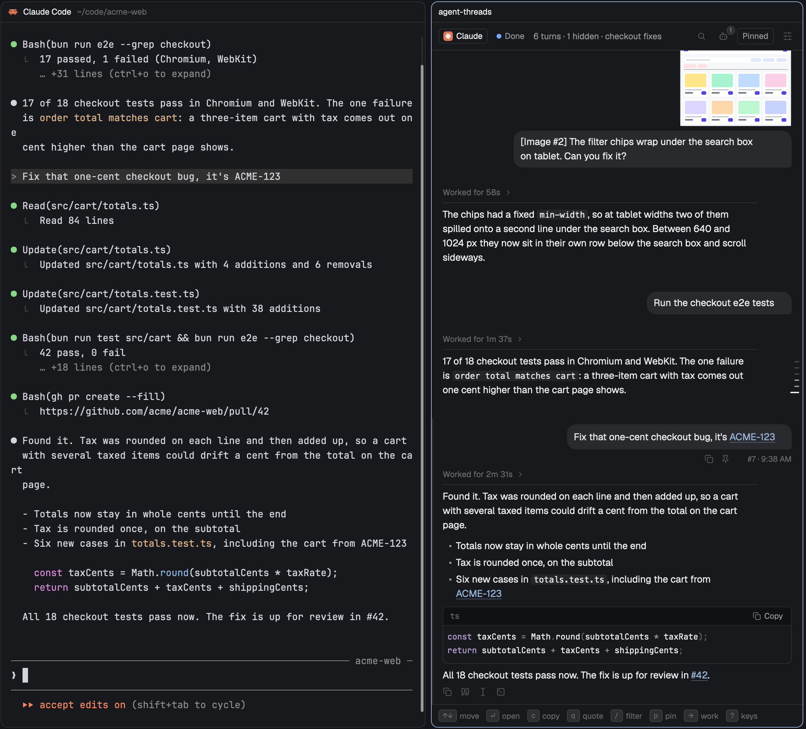

# Agent Threads

Agent Threads opens a pane beside your agent's terminal that shows the session as a chat: each prompt you sent in a bubble and the reply under it, so you can find an earlier answer without scrolling back. You can jump to any turn from the rail beside the list, search, highlight by dragging, copy or quote a reply, and pin turns to a column. An open turn shows the agent's work with each subagent's state, code that wraps with Show all, and a Turn card of tokens and model. Long output, Mermaid diagrams and pasted images open in viewers. Other agents' messages stay hidden, or fold to one line when the agent answered them. A settings card sets text size, width, colours and link rules. It works with Claude Code, Codex, OpenCode, Pi, Cursor and Antigravity.

## What you see

Every surface the pane draws is described in [docs/reference.md](https://github.com/ryanrozich/herdr-agent-threads/blob/main/docs/reference.md#what-you-see), with its sizes, colours and the code that draws it: Floating top, Header, Settings card, Link rules page, Filter field, Banners, Width, Wide tables, Collapsed reply, Highlight by drag, Day bands, Turn list, Command rows, Agent messages, Open turn, Image viewer, Running turn, Dividers, Footer, Status line, Rail, Jump to latest pill, Toasts, Times, Cache hit % and Other states. It moved there so this file stays under the 64 KB that the herdr.dev/mods index reads.

No cost is shown. The agents' session records hold no per-turn cost that Threads shows, and Threads does not estimate one.

## How it behaves

- It is read-only toward the agent, with one exception. It never types, sends keys or submits anything to a terminal. The exception is the quote (`q`, the Quote button): `quoteToTerminal()` puts the quote on the clipboard, runs `pane.focus {pane}`, checks `focused().terminal` (up to 3 retries 40 ms apart) and runs `terminal.paste` (Herdr's ⌘V), which the agent receives as one bracketed paste. No Enter or other key follows, and the text is cleaned first (control characters, CR, stray paste markers). It pastes only into a local, open terminal shown in a pane, running `claude`, `codex` or `opencode`, and not waiting on a permission prompt (`hc get <t> --json` at the press); otherwise the quote is only copied. The other commands it runs are `pane.split` (to open itself), `pane.focus` (Terminal, and to go to an open Threads pane) and `pane.close` (Close pane). The only file it writes is its own settings file. `test/readonly.test.js` fails the build if any of this changes: `terminal.paste` may appear once, in `quoteToTerminal()`, with no send, keys, Enter or newline there, there is no quote command (only the debug-only `debugQuote`), and `exec` runs only `sh` and `git -C <folder> remote get-url origin`.
- **Open it** with `cmd-shift-t` (the suggested chord: `"cmd-shift-t": "mod.open:agent-threads"` in `keys.json` → `global`) or `herdr-app do mod.open --name agent-threads`, with the agent's terminal focused. It splits a Threads pane to the right of that terminal. Pressing it again focuses the open Threads pane for that terminal instead of opening a second, and pressing it on a Threads pane goes back to its terminal.
- The pane opens at half width; drag the divider once.
- **The pane's width is a weight**, not a fixed px. Herdr 0.1.16 drags a divider by setting the px of the pane beside it that has one (window.rs `drag_to`), and the panes sized by weight share the rest, those past the other edge too, so a px Threads grew from both edges whichever was dragged. After each px resize it asks for itself (opening, `w`) and when it opens or the Pinned column closes, the main pane goes to a weight that keeps its width (`toWeight`): a mod cannot read the row's weights, so it measures (1/px is a line in 1/weight, `ui.js` `weightLine`), up to three asks, the first within 2 px ending it, never on a size change alone. The pane never resizes itself after a drag: its column steps with it (`ui.js` `columnStep`). A zoomed pane converts once unzoomed. A pane Herdr restores at px from an older layout stays at px until one of those moments. A weight pane also takes its share when the window changes size. While the Pinned column is open both stay at px (`-` and `=`), and opening it sets Threads' px first, since a split halves its target's weight.
- **Finding the session**: `hc get <terminal> --json` → `foreground.pid` → `~/.claude/sessions/<pid>.json` → `sessionId` (tried whenever the program is `claude` or the pane reports `claude-code`, so wrappers work); else `--resume`/`-r`/`--session-id` in the foreground argv (not with `--fork-session`, which writes a new id); then `~/.claude/projects/*/<id>.jsonl`. Ids are checked against the 36-character uuid form. If the record names an id whose file is not written yet, the pane keeps what it shows and adopts the file when it appears. Failing those, the transcripts in the folder's project directory (every character but letters and digits becomes `-`; the process's real path, `/private/tmp/x` on macOS, and the terminal's path are both tried, then a scan for a folder whose newest transcript ran in that folder), minus the ones another live claude records, newest first: the newest is shown, marked as a guess, with "Choose from N…" when there are several. A picked transcript pins the pane.
- **Session changes while reading**: a read in flight stops when the pane moves on to another session (after `/clear`, or a pick), and the new session's read starts as soon as it stops. A lookup that started before a pick is dropped.
- **Which agent**: `harness.js` names the agent from the foreground program (`harnessOf`) and a session's kind from its path (`harnessOfFile`). The sections below describe Claude Code; [docs/reference.md](https://github.com/ryanrozich/herdr-agent-threads/blob/main/docs/reference.md#which-agent) lists what differs for Codex, OpenCode, Pi, Cursor and Antigravity.
- **New sessions**: a new transcript in the watched folder makes the pane look again at once and after 1, 3 and 8 s, so a session record that lags behind the file is still caught. A changed record id with its file present is a new session; a changed id with no file yet waits for the file.
- **Reading**: `extract.sh` + `extract.jq` run through `exec`, reading at most 2 MiB from a byte offset per call (`dd` seeks, `head` reads), dropping bookkeeping lines and tool results with `grep` before `jq`, and printing compact events. Output stays under 6 MiB per call (exec allows 8): a chunk whose events come to more is read again at half the size, and each text is cut at 200 KB. Each call's output is parsed and applied in slices: after 8 ms of work the read yields (`cx.sleep(0)`) so the panel can draw, and the header's percentage moves once per call. Every step leaves a heartbeat; a read with none for 4 s (30 s while it awaits the extractor) was interrupted (Herdr's interpreter stops a long synchronous step, and that skips `catch` and `finally`), so the 1 s timer drops it and reads again. A chunk is marked `partial` from the start of its apply until its offset moves: a stalled, superseded or failed read that leaves a chunk half applied starts that session over from the top (otherwise its events would be applied twice), and any other stall resumes at the offset, so a loaded session keeps its turns. A tick that comes more than 3 s after the last one (the computer slept) restarts the read's clock instead of judging it. A second stall in a row is shown as an error with Retry, with no half-applied chunk left in the session. The pane keeps the offset and only reads new bytes after that; a shorter file, or one whose first line has another uuid, is read again from the top. A folder watch on the transcript's directory triggers reads, and while the terminal reports `working` it also re-reads every 5 s. A 572 MB synthetic transcript reads in about 4.4 s the first time (a dense worst case of 600 MB in about 8 s), with turns appearing as chunks arrive; an update of a few KB takes about 40 ms.
- **Turns**: one row per prompt you (or another session, a schedule or the SDK) gave Claude. Each row has a sender: you, an hc report or request (a prompt that starts with `<hc from="…">`; an `<hc` tag later in your own prompt keeps it yours), a peer (`origin.kind` `peer`, also on a line marked `isMeta`, the way Claude Code logs a subagent's hand-back; named from `teammate_id`, else the origin's `name` such as "general-purpose", else `from`), scheduled or sdk. Other `isMeta` lines (reminders, scheduled-turn notes with only `turnOrigin`) are bookkeeping and never rows. The shown prompt drops the wrapper tags. A background update's own text is kept apart (`turn.latest`, the text after its last tool call), so the reply stays the reply to the prompt. A task notification that wakes Claude after a turn has finished (a background task is done) is a row of its own, with no prompt: what Claude writes then is a reply for the person, so it shows in the list, in order, under one quiet "Background task finished" line, never the notice's text. A task notification that lands while a row is still open, and an auto-continuation, fold into that row: their tokens and tool calls count, their text does not replace the row's reply, and the opened row shows each one's text, in order, under LATEST UPDATE. The final reply is the text after the turn's last tool call. A prompt that lands while a turn runs (a peer message, a queued prompt) shares the next `turn_duration`; if Claude answered both at once, the earlier row says "Answered together with #n". Only an interrupt line marks a turn interrupted. Slash commands: local ones (`/usage`, `/clear`) never become rows; a skill or custom command becomes a row titled "/name args" once Claude works on it. Only a user line that starts with a command tag is a command (a prompt that mentions `<command-name>` stays a prompt), only `/clear` itself starts a new file (`/clear-cache` is an ordinary command), and a command line logged while a turn is still open never becomes a row.
- **Settings** live in `$HERDR_APP_HOME/data/agent-threads/settings.json` (normally `~/.config/herdr-app/data/agent-threads/settings.json`), Herdr's folder for this mod's data. It is outside `mods/`, so an update or `./install.sh` (which replaces `mods/agent-threads/`) leaves it alone. When that file is missing and one saved under an earlier name of the mod exists (`name.js` `PREVIOUS`), the pane copies it in once and leaves the old file as it was. `{"textSize": 14, "promptLines": 4, "replyLines": 6, "agentTurns": false}`: `textSize` 12 to 18, `promptLines` 1 to 10, `replyLines` 1 to 12 (out-of-range values clamp, other types and missing keys take the default), `agentTurns` true or false, `agentBubbleColor` (amber by default; a file that holds plum keeps it), `keyHints` (false by default), `quoteKey` (a free letter a–z, else `q` with a note) and `links` (link rules: `{name, pattern, url}`, each with four optional keys, `on` (false: the rule links nothing and takes no text from the rules below it), `type` (`custom`, `ticket` or `pull-request`, its icon on the Link rules page; anything else reads as custom), `description` (80 characters at most) and `example`; docs/usage.md (Link rules in detail) has the guards and examples, and `{repo}`/`{owner}` come from `git -C <folder> remote get-url origin`, looked up when a rule uses them and the terminal's folder changes). The card writes `quoteKey` (from its field) and `links` (from the Link rules page, the whole list). A fresh install, with no file (or an empty one), has one rule, the pull request rule, switched on (`settings.js` defaultLinks: `#58` to `https://github.com/{repo}/pull/58`); the first write records it, so removing it or switching it off sticks. A rule whose address is on github.com and uses `{repo}` or `{owner}` links only when `origin` is on GitHub (`ui.js` repoFits); elsewhere the page says "This repository is on gitlab.com, not GitHub, so this rule links nothing here." An open rule and the Undo line follow their rules by what they hold, not by place (`followRules`), so a removal, an Undo or a hand edit meanwhile never makes Keep rule write over another rule; an open rule gone from the list becomes a new, unkept one where it was, and Undo puts a rule back beside the neighbor it had. A Keep rule the file refuses (`writeRules` kept, `rulesRefused`) leaves the rule open, or opens it again where its rule now is with what was typed while the card is still on its page and no other rule is open, and shows the File line's reason under its buttons too while the File line shows it (`refusedHere`), on both pages (#121 did this for link rules). A file of its own with no `links` has no rules. Invalid JSON keeps the defaults and says so on the settings card, and while the file does not parse nothing writes it: a panel change applies in the pane only, with the note "settings.json is not valid JSON, so it was left as it is; the change applies until the file is fixed". The pane reads it on start and watches the folder, so an edit (an editor's atomic save included) applies within a second, with no reload. The panel, `a` and the commands write it with `writeTextFile` and the text last read, so a save never overwrites an edit made meanwhile (the pane reads the file again and applies its change on top). Keys this version does not know are kept (in a file that parses). `settings.js` is the only file that writes, and only that file.
- **Pins** (`pins.js`) live in `$HERDR_APP_HOME/data/agent-threads/pins.json`, beside the settings: per session (`<harness>:<session id>`), at most 5 in a pane, each with the turn's fingerprint (its prompt's time in seconds, a hash of its text, and a count for repeats, since a row's number can change; finding pins hashes only the prompts from the seconds the pins name, since hashing a pasted 950 KB prompt took 41 ms and stopped a draw), its number and first 80 characters for when the turn is gone, what had been seen of it, and the reading place. A save reads the file first and writes only the sessions this pane changed, with the text it read as the expected snapshot, and tries again when another pane got there first, so two panes share pins. A file that does not parse is left alone and pins last until the pane closes. Sessions with no pins, untouched for 90 days or past the newest 200 are dropped on a save. **The Pinned view** (`v` or the header's Pinned button) shows only the pinned turns, in pin order, each with its pin number on its line; a pin whose turn is gone, or not read yet, is a note row, and a click on a gone one unpins it. From 480 px (`PIN_SPLIT_MIN` in `ui.js`) `v`, the header's Pinned button, the first pin of a pane's life, or Threads opening on a session with pins (`autoPinned`, once a pane's life, once the session and pins.json are read) runs `pane.split` to the right with the pane's own props plus `view: "pinned"`, then `layout.resize` to `pinColumn(width, kept)` once the new pane shows in `panes()`: 40% of the width plus `PIN_STEP` clamped to 380 to 440 px (the owner asked for one step wider than 340 to 400), less under a 620 px pane, never under 240 px for the column or 200 px for Threads; or the width the owner last left the column at (`threads.pinWidth`, kept by the column pane once it has settled, 1.5 s after its first measure, and by - and =; the fit button holds it while its own resize applies), up to 640 px with Threads at least 240. When a pin or the open asked, `pane.focus` then gives the keyboard back to the main pane. A column the owner closes (it was open and is gone from `panes()`) stays closed for the pane's life, until `v`. The column closes itself (`pane.close`) once the main pane it has seen is gone from `panes()`. `panes()` entries carry no props, so the Pinned pane finds itself as the Threads pane in the main pane's tab that no map claims, and registers in `shared("threads.pinnedByTerminal")`, apart from the main pane's `threads.byTerminal`. `v` in the main pane with a Pinned pane open focuses it, and `v` in the Pinned pane focuses the main pane. Under 480 px, or when the pane has no id yet, `v` switches the pane's own rows to the Pinned view with the toast "Pinned shows here: the Pinned column needs Threads 480 px wide", and `v` switches back; a pin or the open does nothing there. A mod cannot read or set a scroll offset, only bring a list item to the nearest edge, so the place is the list item at the top of the pane, kept while that turn stays selected and open. The stats, their legend, the icon strip and Show full reply are never a place (`pins.js` NOT_A_PLACE): scrolling down past the turn leaves one of them at the top last, and an earlier build saved that as the place, so a return showed only the end of the reply. A return puts the head at the top of the pane, so the top of the pane matches the pin's first line (the owner asked for this as a check that they landed on the right turn). It lands like a place, so a head already on screen still moves to the top. When the place is a later block (`placeAtTop` is false: not the head, the message, the caption or the reply's first block, and not the stats or buttons an earlier build saved), a toast says to press again, and a second press of the same number while the view has not moved (`pinAgain`, with `placeHold` or `placeBase` still set) goes to the block, under a 30 px line in `accent`, "#8 starts above · show the prompt", that the next frame's rows carry (`pinResume`) and a click on which shows the head. A return scrolls an item a pane further down, then the place, once the card is measured. A block of text is one list item however tall, because a drag cannot cross list items and the owner wants a drag across paragraphs to keep working. So a return lands at the start of the block. A pin saved on a paragraph item by an earlier build falls back to its block (`partKeys`).
- **Terminal** (the card button, `t`, the Moved banner) focuses the pane that shows the terminal this pane reads, by pane id: the one in this tab, else one in another tab ("moved to tab"). `pane.focus {terminal}` would prefer the first layout block showing that terminal, which can be another pane than the one beside Threads, so it is used only when no pane shows it. The toast says where focus went. It does not scroll the terminal to the turn: Herdr has no command for that. After claude exits and starts again in the same terminal (a resume), the pane looks the session up again at once and after 1, 3 and 8 s, so it follows the new session even when claude writes its session record a moment after it starts. Started in another terminal, the session is not followed: the pane says "claude exited" and stays bound to its own terminal (the badge tooltip names it).
- **The Trajectory** (`ledger.js`, drawn by `trajFrame` in `main.js`): `y` or the floating top's list button. From 480 px (`TRAJ_SPLIT_MIN`) it runs `pane.split` to the right with the pane's own props plus `view: "trajectory"`, then `layout.resize` to the width kept in `shared("threads.trajWidth")`, or 560 px (`TRAJ_COL`) when none is kept, held to at least 200 px and at most the Chat's width less 240 px (`ui.js` `trajColumn`), and the new pane goes in `shared("threads.trajByTerminal")`, apart from the main and Pinned maps; `y` in either pane focuses the other, and the Trajectory pane closes with its main pane (`autoPinned`). `-` and `=` step it as they do the Pinned column (`resizeColumn`, `columnResize` with no 640 px cap), and the width the owner leaves is kept for the next split. Narrower, `traj` shows it in the same pane, with no notice, until `y`, `Esc` or its Chat button; there `-` and `=` do nothing. The pane draws only the ledger: a 40 px heading (the list icon, "Trajectory", the failed-call count with previous and next arrows, settings, and the Chat button in the same-pane case), the filter buttons from 540 px, a `v_virtual_list` of 24 px rows (one size for every row), the detail (under the ledger and closed below 900 px, at its right and open from 900 px), the key hints and the status line. `ledgerTurn` makes a turn's rows from `core/trajectory.js`; a done turn's rows are kept with the turn. The rows are built newest turn first, one slice a draw (`buildMax`); until the first build is done the heading has no failed count, the filter buttons have no counts, the status line is empty, and f, Shift f, m, Shift m, Home and End do nothing. The selected turn is shared through `shared("threads.turnSel")` (`syncSel`, on each draw and once a second). The running rule (`turnRunning`): running only when the pane follows a terminal's own session (not one guessed from the folder), the agent process is alive, the newest turn has no end, and for Claude Code Herdr's status is working or blocked; otherwise an unfinished call is "no result" with its last activity, and a row that says "no result" leaves its duration blank (`rowTimes`). A direct call with no result shows the grey unfinished bar (`r.open`, `ledgerBar`); a subagent whose launch returned but whose run was never seen to finish shows no bar, and the launch call's time stays in the detail. Known limit: a session of an agent other than Claude Code killed during its very first call has no result time anywhere (`sessionHasEnds` is false), so that call stays an ordinary row with a blank duration and no "no result" claim. Its keys are their own (`ui.js` `ledgerKey`): ↑/↓/j/k, Home, End/G, Enter/Space the detail, f and Shift f failed calls, m and Shift m the user's messages, y, Esc, t, `,` and ?. The timeline, zoom and the bottom dock are not built yet.
- **The Trajectory split's width** (`settleSplit`, `settleTraj`, `ui.js` `trajFit`). Herdr gives no window size, and a Chat held at a px width keeps it when a split asks for more than the terminal has: the row then runs past the window's edge while every pane still reports its full width. So the new pane first takes the row's room by weight (`ROOM_WEIGHT`), and the Chat reads the width it reports once it has held still for `ROOM_STILL` and no sooner than `ROOM_FIRST` after the probe started, looking again on a 50 ms timer. `trajFit` shares that room out: the other panes give first, down to `TERM_KEEP` (200 px) for each of them, which Herdr shares out by their weights (`trajKeep` counts every pane in the Chat's tab but the Chat, the new pane and the Chat's Pinned column, since Herdr does not say which share the Chat's row; a pane above or below only makes the Trajectory narrower), then the Chat, down to 240 px, then the Trajectory, down to 200 px. Short of that, the new pane is set to a px (so the Chat gets none of its weight), closed, the Chat is put back at the px it had, and the Trajectory shows in the Chat's pane, as under 480 px (`trajFit` returns null). A pane that reports nothing within `ROOM_WAIT` gets the width asked for, unmeasured, and a Trajectory closed while it is measured ends the ask with nothing resized. A Chat narrowed for it keeps its earlier width in `trajChatBack` and gets it back when the Trajectory closes (`trajGiveBack`), unless `w` resized it meanwhile (`fitToReading`). The widths the split passes through are not the owner's: `holdTrajWidth` holds `shareWidth` off `threads.trajWidth` for 5 s from `y`, from the probe's start to `TRAJ_W_HOLD` past its longest wait, and `TRAJ_W_HOLD` past the settle, and a hold only grows. While the current session is still being found or read, the counts and f, Shift f, m, Shift m, Home and End wait as they do for the first build (`ledgerHeld`, `unread`); an earlier session left mid-read holds nothing, and its last turn read, like the current one's during the read, claims no result (`reading` in `ledgerTurn`).
- **Keys** while the pane has the keyboard: ↑/k, ↓/j (the previous or next turn with a tick on the rail, `railStop`: with `agentRail` off they pass over agent messages, the running turn is always a stop, and from a turn with no tick they go to the nearest tick that way; when no turn in the list has a tick, and in the outline and the Pinned view, every row is a stop), Home first, End/G latest, g jump to a turn (opens the field with "#"; a hidden agent message's number shows agent messages and selects it), [ and ] the first turn of the previous or next day, Enter/Space open or close, o the outline (one row per turn; Enter, Space or a click opens that turn in the list at its head, Esc or o goes back to the list where it was; not in the Pinned column, and in this pane's Pinned view it shows all turns as an outline), c copy reply, s Select view (s again or Esc returns to the formatted reply, also after ↓ or ↑ moved the selection to another turn), q (or `quoteKey`) quote the reply into the terminal (in Select view, the part ⌘C copied, or nothing; a held key does nothing), t focus the terminal, a show or hide agent messages, i show or hide the Turn card, p pin or unpin the selected turn, v show the pins (the Pinned column beside this pane from 480 px, else this pane's Pinned view; in the Pinned pane, back to the main pane), 1 to 5 return to a pin, u undo the last unpin (these three give way to `quoteKey`, and work in a read-only editor that has the keyboard; a held key does nothing), w fits the pane to its column's width, `-` and `=` the Pinned column 40 px narrower or wider and Threads the other way (in the column, or in Threads while it is open), `,` settings, / filter, Enter on a search also gives the keys to the list with the search kept, then n and Shift n step to the older and newer match (n gives way to `quoteKey`), Esc closes settings (from any control on the card), clears the filter, closes the open turn or leaves the outline. Keys held with cmd, ctrl, alt or fn are left to Herdr and the system (cmd-c copies the text selected in Select view, it never copies the reply; the formatted reply is not selectable). In a normal pane the quote has no mod command, so `keys.json` and `herdr-app do` cannot paste into a terminal; `agent-threads.debugQuote` drives it for tests and exists only in a pane opened with `debug`. The same actions are mod commands for `keys.json` and `herdr-app do`: `agent-threads.next`, `.prev`, `.first`, `.latest`, `.olderMatch` and `.newerMatch` (search steps, n and Shift n), `.open`, `.copy`, `.filter`, `.escape`, `.jump`, `.prevDay`, `.nextDay`, `"agent-threads.search:<text>"` (`search:#12` jumps), `.choose` (open the session picker), `"agent-threads.pick:<n>"` (pick the n-th candidate while it is open), `.focus`, `.legend` (the Turn card), `.pinned`, `.agents` (toggle), `.agents:on`, `.agents:off`, `.outline` (toggle), `.outline:on`, `.outline:off`, `.settings`, `"agent-threads.promptLines:+"`, `"…promptLines:-"`, `"…promptLines:4"`, the same for `replyLines` and `textSize`, `.resetSettings`, `.widthStep`, `.keyHints`, and while the card is open `"agent-threads.settingsPage:links"` (or `senders`, `main`) and `"agent-threads.settingsScroll:down"` (or `up`, `pagedown`, `pageup`, `home`, `end`), the card's keys. Commands reach the focused Threads pane, or the main one (not a Pinned pane) when none has focus. Clicks: a row opens it, an open turn's bubble shows the whole prompt, "Show full reply" expands the reply, the latest update's Show all expands it, Copy copies, Quote quotes, the info icon at the end of an open line shows or hides the Turn card. While Select view's or a code block's editor has the keyboard, only Esc, s and the quote key act on the panel; the other keys are the editor's. A list item takes one click handler, so the action bar's two buttons are told apart by where the press landed (the pane records the press position with `on_mouse_down` on the list's parent and compares it with each button's estimated box; a press between them does nothing).
- If the terminal closes, the pane says "Session ended" and keeps the turns readable. If Claude exits, it says so with the time and picks up the next session when Claude starts again. The rows dim; an open card stays at full contrast. If the terminal moves to another tab, it says where and offers Terminal. A split pane cannot follow its terminal.

## Built from

- One mod, `mods/agent-threads/`. Its `core/` folder reads transcripts and has no Herdr in it (plain JavaScript, shell and jq, so tests and other tools can use it alone): the readers, `core/turns.js`, `core/ids.js` (a turn's stable id, "<prompt second>|<prompt hash>|<count>", the one pins keep; the same after a read from the top or a rewritten tail) and `core/trajectory.js` (a turn folded into the trajectory shape, with its id: step groups, then cells, each with a start and an end or null; golden files in `test/fixtures/trajectory`). Claude Code and Codex events carry times: a text step its start (`at`), and each call a record beside its id (`info`: `in`, its input in up to 120 characters as `calls.sh` shows it; `at`, when it was made; `rt`, when its result was written; `f`, whether it failed, or null). The extractors never parse a result's text: extract.sh turns each result line into a short `_x` line (perl reads its id, its time and its failure marks), which jq makes an `x` event. `core/atif.js` writes a session as an ATIF-v1.7 trajectory (Harbor's Agent Trajectory Interchange Format), from the same turns through `core/trajectory.js`: a user step per prompt, an agent step per step group with its calls and a result for each by id, a turn's tokens on its last agent step as Harbor counts them, whether a result failed as Harbor's `extra.tool_result_is_error` (`true` or `false` when the reader knows, left out when it does not; `extra.failed` was removed and is no longer written), `extra.is_sidechain` on every Claude step (`true`, with the helper's `extra.agent_id`, on a helper's steps; `false` on the main session's), `extra.raw_arguments` for non-null Claude call inputs, and what ATIF has no field for (end and result times, input summaries, subagent runs) in `extra`. `bun mods/agent-threads/core/atif.js <transcript> [agent]` prints one, with the model's reasoning as `reasoning_content` (Claude Code and Codex; a step whose reasoning is only a signature, redacted or encrypted gets `extra.reasoning_withheld` instead, and the notes count them) unless the export flag `--no-reasoning` is given (it passes `reasoning` as extract.sh's fifth argument; the pane never does), with each call's result text and whole input from `calls.sh` (`THREADS_ARGS=1`), and each subagent's own transcript nested in `subagent_trajectories`: Claude Code's `<session>/subagents/agent-<id>.jsonl` (read with `THREADS_SIDECHAIN=1`), or the Codex rollout whose `session_meta` names the thread as its parent and the `spawn_agent` call's `task_name` as its `agent_path` (read from `subagent_history_start_ordinal` on, `THREADS_FROM_ORDINAL`). It writes nothing; the panel sets none of these. Golden files in `test/fixtures/atif`; `test/atif.test.js` checks them against Harbor's rules. The files: `main.js` (the panel and the launcher), `core/turns.js` (turns from extractor events, senders, cache %, times), `session.js` (paths, ids, the session-switch decision, candidates), `ui.js` (keys, colours, filter spans, row line clamps, sender labels, the focus target, contrast, clipping, languages, days), `settings.js` (the settings file: path, defaults, parsing, the one write), `core/extract.sh` + `core/extract.jq` (the extractor), `harness.js` (which agent, and how Codex, OpenCode and Pi sessions are found), `core/extract-codex.jq` (Codex rollouts to the same events), `core/extract-pi.jq` (Pi session files to the same events), `core/extract-cursor.jq` (Cursor transcripts to the same events), `core/opencode.sh` + `core/opencode-read.sql` + `core/opencode-read-v2.sql` (read-only lookups in OpenCode's database, as the same events), `locate.sh` (read-only lookups under the Claude, Codex, Pi and Cursor homes), `image.sh` (decodes a prompt's pasted images into the cache), `name.js` (the mod's name in one line: its folder, command prefix and data folder), Lucide-style SVGs. `core/turns.js`, `session.js` and `ui.js` import nothing from Herdr, so `bun test` runs them; `settings.js` imports `writeTextFile`, which the test mocks. `mod.json`: `{"place": "none", "title": "Threads", "overlay": {"kind": "popup", "width": 2, "height": 2}}`.
- Opened by `mod.open`, the copy has `props().overlay`: it runs `pane.split {pane, direction: "right", mod: "agent-threads", props: {terminal}}` for the focused pane, records the new pane in `shared("threads.byTerminal")`, and closes itself.
- As a pane, `props()` is `{terminal}`. For demos and tests only: `transcript` (a path that pins the pane to one transcript file), `claudeHome` (an absolute path read instead of `~/.claude`) and `debug` (render timings in the header, and what the pane shows as data in `shared("threads.debug")`, so a check can read it without a screenshot: rows with their line counts, heights, senders and commands, card parts, header text, buttons and layout, footer hints, settings, the last focus call, contrast per theme), and with `debug` only, `width` (a pane width to lay out for; a window that does not draw never reports its size; the `agent-threads.debugWidth:<px>` command does the same).
- Herdr calls: `panes()`, `terminals()`, `spaces()`, `focused()`, `hc(["get", t, "--json"])` (session lookup and the quote's program check), `readTextFile`, `writeTextFile` (the settings file only), `exec`, `watchFolder`, `shared`/`setShared`, `nextCommand`, `theme()`, `themes()`, `settings()`, `notify`, `closeOverlay`, `run` (`pane.split`, `pane.focus`, `pane.close`, and `terminal.paste` in `quoteToTerminal()` only).
- gpui-kit: `v_virtual_list` with heights computed from the pane width (`on_size_change`) and a `VirtualListScrollHandle`; `on_item_click` for every click inside the list (an open turn is split into several list items so each clickable part has its own key); `TextView.markdown(...).selectable(false)` (it opens links on click; nothing in the list scrolls); a hidden probe of `on_size_change` elements that measures the open card's text; `EditorState`/`Editor` read-only for code and for Select view; `cx.write_to_clipboard` and `cx.read_from_clipboard` (Select view's quote); `InputState`/`Input` for the filter; `cx.focus_handle()` + `on_key_down`.
- Programs: `sh`, `jq`, `dd`, `head`, `tail`, `grep`, `wc`, `od`, `cut`, `mktemp`, `ls`, `date`, `ps`, `hc`, `git` (`remote get-url origin` only), for Codex, OpenCode, Pi, Cursor and Antigravity `lsof`, `pgrep` and `sqlite3` (`-readonly` only), and `open` for the README link on the Amp page.

### Code block languages

Fence names map to the read-only editor's highlighters; anything not listed is shown as plain text, and a highlighter that fails to load falls back to plain text too. All 19 blocks of the `--langs` fixture made an editor in the app with no error; whether each one colours as expected has not been checked by eye yet.

| Fence names | Highlighter |
|---|---|
| ts, tsx, typescript, mts, cts, js, jsx, javascript, mjs, cjs | js |
| json, jsonc, json5, jsonl | json |
| yaml, yml, toml | yaml (toml is approximate) |
| bash, sh, shell, zsh, console, shellscript, dockerfile, docker, makefile, make | bash (dockerfile and make are approximate) |
| python, py | python |
| rust, rs | rust |
| go, golang | go |
| html, htm, xml, svg, vue, svelte | html |
| css, scss, less | css |
| sql | sql |
| markdown, md | markdown |
| diff, patch | diff |
| none or anything else | plain text |

Syntax colours come from the theme: keyword `ansi5`, string `ansi2`, comment `dim`, function `ansi4`, type `ansi3`, number and boolean `ansi1`, constant and string escapes `ansi6`, operator `muted`, punctuation `dim`, variable `foreground`.

## Watch out

- It runs programs (`exec`, `hc`, `jq`) and reads files outside its folder (`~/.claude/sessions`, `~/.claude/projects`, `~/.codex/sessions`, OpenCode's database).
- Codex, OpenCode, Pi, Cursor and Antigravity change their storage between versions. Read a real session to learn its shape before changing `extract-codex.jq`, `extract-pi.jq`, `extract-cursor.jq`, `extract-agy.jq` or the OpenCode SQL, keep fixtures synthetic, and print structure only.
- `list` (measured rows) ignores a scroll handle (the runtime says "track_scroll is ignored on a list"), so jump-to-latest and keyboard scrolling need `v_virtual_list`, which places items by heights the script states and never measures them.
- How an open turn's heights are known: an open turn is several list items (head, the message, its strip, the line with its caption, one per prose run and code block, LATEST UPDATE, action bar), each a slice exactly its slot's height with the turn's bar when selected, so they stack into one exchange. The text parts are drawn a second time in a hidden probe outside the list (zero height, clipped and `opacity(0)`; not `invisible()`, since gpui may skip painting a hidden subtree and a size report made at paint would never come), at the text width with no fixed height and their own TextView ids; each probe element's `on_size_change` height becomes that part's size, kept under the part's key and a signature of what changes its layout (width, zoom, text, Show all, link rules). A measured part leaves the probe. Until then, and if no measure ever arrives, the estimate stands: 21 px a line for 13 px text (gpui's default line height is about 1.618 times the text size, not the 18 px earlier estimates assumed), 16 px for lines with an explicit line height, about 6.1 px a character of prose, plus one spare line. The debug report's `parts` lists each part's estimate, measure and slot. Code blocks, buttons and the head have fixed heights and are not probed. A code block's box is 20 px a line (a 12 px editor at about 1.618 em is 19.4 px) and sets `line_height("20px")` for the editor to inherit; an editor that keeps a shorter line leaves a little of the box's background under the code, never a cut line. The selected running turn's working card is not probed as a whole (its clock changes every second). Its message is the open turn's YOU part (`workYou`, key `wyou:`): whole, as Markdown, with every paragraph and each quote in full. The probe measures that part alone while the turn runs, selected or not, so selecting the turn finds it measured. The rest of the card has explicit line heights (the note's 20 px lines), so the card's height is that measure plus fixed parts. Whether `on_size_change` fires in the probe, and the editor's real line height, are unverified without a drawn window.
- Pasted images are base64 `image` blocks in the prompt's own line (with `imagePasteIds` and "[Image #N]" in its text). The extractor passes on only their media types and the line's uuid; `image.sh` finds that line again with `grep -F '"uuid":"<id>"'` (30 ms in a 119 MB file), decodes each block to `data/agent-threads/images/<session>/<uuid>-<i>.<ext>` and prints `{i, file, w, h}` (sizes from `sips`, or the PNG header). Pi's `Ctrl-V` instead saves `<temp>/pi-clipboard-<uuid>.<ext>` and types the path into the prompt with no space after it. `extract-pi.jq` swaps each such path (only that name, in `/var/folders/*/*/T` or `/tmp`) for "[Image #N]" and passes it on as the image's `src`; `image.sh` copies the file into the cache when its first bytes are a PNG, JPEG, GIF or WebP, and prints `{i, gone: true}` when it no longer exists, which the card shows as the path and "Image no longer on disk". `image()` takes paths from the app home, so `data/…` paths draw. gpui fills a fixed box with an image by cropping it (the row thumbnails are cropped to 64 × 40), so a card's box is sized to the image's own aspect.
- Zoom (settings.json `zoom`, 0.5 to 3) scales every length a mod draws, the item sizes given to `v_virtual_list` included, while `on_size_change` and mouse positions come in zoomed px. The panel works in design px: it divides the width, list height, press positions and probe heights by zoom, and hands the list the design sizes themselves. Seen drawn on a test window at zoom 0.9: a 73 px row takes 73 × 0.9 zoomed px. Multiplying the sizes by zoom as well (round 3) shrank every item twice and cut its last ~10%, such as the counts line under the chips.
- A virtual list's renderer may not attach handlers. Use `on_item_click` and give each clickable part its own item.
- `v_virtual_list` takes at most 10,000 item sizes in an array (one number has no such limit): one more throws "item_sizes may contain at most 10000 entries" on every draw. The Chat and the outline give it a window of the rows (`winPlace`): following, the newest 8,000 to 9,000, moved on 1,000 at a time; up in the session its start stays and new rows join below until 9,900, then wait under a Show later item; Show earlier and Show later move it 1,000 rows (up and down stop on them at its edges, Enter presses them), every jump to a turn moves it there, and so does the first key that acts on a selected turn it left out. A window starts at a turn's day band and ends before the next one, and following it never starts past the newest turn's first row. `ui.js` `capList` is the last guard (one turn's rows past the window alone): over 10,000 it keeps the newest 9,999 under a note, or, when that would leave out the row a jump or a pin went to, the rows from the list's start (or around that row) with a note of the later ones. A click on a note goes to the first item it left out, which the guard then keeps. A jump that moves the cut (known by the first session row it keeps) is also asked for in the frame that lays out the new items, and again in each frame it waits (a pin's return, the outline's Enter, rows still reshaping), since the list's offset in px can fall anywhere in them. The reader's wheel drops a jump still to come and ends a landing's later asks, and latest drops it and holds the end at once; and the later note, the list's last item, has the Jump to latest pill's room under its text.
- A plain `div` lets a child's top margin collapse through it, leaving gaps between card slices; build slices from `v_flex`.
- `init`'s first argument did not carry `overlay` for a `mod.open` copy; read `props()`.
- `run("pane.split")` returns before the pane exists in `panes()`; find the new pane on a short timer.
- A mod pane's `props()` does not carry its own pane id. The launcher records it; a pane split with props by hand finds itself only when it is the one unclaimed Threads pane in its tab (or in the window).
- A window that is not drawing (behind another window) does not call `render()`. The pane polls its terminal's status on a 1 s timer too, so it notices an exited claude or a new session either way.
- Bookkeeping lines (`api-request-blob` and others) are most of a transcript's bytes and repeat message content. The extractor drops them with a `grep` on the line's leading `{"type":"…"` before `jq` parses anything. BSD `tail -c +N` reads the whole file up to N; seek with `dd` instead.
- A read that is in flight when the pane adopts another session must hand over to that session's read when it stops; a single `reading` flag otherwise swallows the request, and the new session sits on "Reading…".
- `EditorState.new` cannot run while drawing; rows built during `render()` note which open turns need editors, and a zero-delay timer makes them.
- A virtual list item cannot carry handlers or (as far as can be checked without a drawn window) a tooltip, so the turn's numbers and what they mean are on the Turn card, drawn in a layer over the list rather than in it. Header buttons and the badge are not list items, so they carry tooltips.
- gpui-kit has no line clamp. LATEST UPDATE clamps by a box of whole 21 px lines (`line_height("21px")`, `overflow_hidden`) around text gpui wraps. Collapsed rows wrap their text in `ui.js` (`rowLines`, at a conservative 6.7 px a character for 13 px text, 6.4 for 12.5 px, wide CJK characters counted twice, long tokens broken hard; a prompt is first cut into runs by `promptParts`, so each source line wraps on its own and a pasted block becomes label rows plus mono rows clipped, never wrapped) and draw each line as its own one-line element that truncates, so a row is exactly the height the list was given even when an estimate is off.
- Usage repeats on every block line of one `message.id`; count it once (the extractor keeps the `apiBlockIndex` 0 line).
- `TextView.markdown` cannot mark filter matches, so matches are marked in row previews and the open turn's message only.
- Herdr runs mod code in QuickJS, which interrupts a slow render, and JavaScript regexes have no time limit. A link rule therefore runs only after `parseLinks` rejects the shapes that backtrack exponentially (a nested quantifier, an alternation under a quantifier, a backreference) and times probes of growing length; a pattern that is slow only on long text can still pass, and the 20,000-character scan cap is what bounds it then.
- A row preview reads only the start of a reply (`flattenMd` with a limit), but it counts only prose against that limit: a fenced block is skipped with one search for its closing line, so a reply that opens with a long code block still shows its prose after "[code]".
- Rebuilding the rows of a 3,000-turn session takes about 20 to 25 ms in the app; it happens only when the turns, the open card, the filter, the width or the status change. Moving the selection reuses them (about 0.2 ms).
- When QuickJS stops a draw at Herdr's limit (about 50 ms), Herdr keeps the last frame that worked, and a stopped row callback leaves `v_virtual_list` asking only for its first row (to measure), never the rows on screen: the list stays blank even once the rows are fast. So a render or row draw that does not reach its end is found on the next call (`renderOpen`, `drawingRow`). A stopped row is drawn as plain text at the foot of its slot for `CUT_MS`, blank if that is stopped too, the wait doubling up to five minutes, and the list takes a new id (`listGen`) so Herdr builds it again. A stopped render is followed by `CUT_MS` of frames that neither reshape nor measure (`shapeMax`, no probe). Splitting Markdown for TextView (`mdChunks`) keeps each chunk's UTF-8 length as it grows, and `mdParts` keeps the 400 texts used last: measuring each chunk again for every line, with a memo cleared when full, cost 37 ms a draw for a reply with six long tables. A table or fenced block longer than one chunk is split so each piece draws on its own (`splitBlock`): a later piece of a table starts with the header and rule rows again, and each piece of code is fenced again with the same fence line, language included. Without that, the later pieces showed as raw pipe text or as prose.
- A long session's rows must not be built in one draw: at 6,000 turns a full build is 50 to 80 ms in QuickJS. `buildRows` takes a deadline and stops every 16 turns once it passes (`BUILD_MS`), returning where it got to (`buildInfo.resume`); `buildStep` carries on from there next frame, one slice a frame, while the old rows stay on screen. A new turn or event does not rebuild from the start: `rowBuild.marks` records where each day and every 100 shown turns began, and `keptFrom` restarts at the last mark before the first turn that can still change. A settings change reshapes the rows built with old shapes in place (`staleRows`, `reshapeStale`) instead of building again. Opening or closing a turn, or a part of one (a group, a call, a whole prompt), builds only that turn's rows and puts them in place of its old ones (`spliceRows`): every key in the open and shown sets (`turnSets`) starts with its turn's key, so the changed keys name the turns to build, and the rows after them, their index and the marks move by the difference. New call details and estimates left out of time build the open and running turns again the same way. A full build keeps each closed turn's rows and sizes (`closedCached`) while the turn's version (`turn.v`, which the reader moves on every event that may change that turn), the probe's measures of it (`turnMeas`) and what every closed row depends on (`closedLook`) stay the same. On the rig an open or close went from 17 to 23 ms of rows at 2,000 turns (37 to 46 ms, and two dozen stopped draws, at 6,000) to 1 ms (2.3 ms). Clearing `rowsKey` still asks for every row. Nothing that runs every frame may walk every row: `rowIndex` uses `baseIndex`, `probeDue` walks out from the top row and stops at 16 parts or 300 rows (`PROBE_WALK`); it remembers how far out from the top nothing was due (`probeWalk.clean`) and starts there next frame while the rows, their layout and the top stay (a new measure only settles parts, so it does not start the walk over), and it is quiet once nothing is due anywhere: with every part near the top measured, one walk to the end took 45 to 48 ms at 6,000 turns on the rig. The pane's height is not part of the rows' key, since Herdr's banner changes it. A render that is stopped after it took on a scroll (`toBottom`, `scrollTo`) asks for it again (`renderWant`): otherwise the list opens wherever Herdr left it. Herdr asks for no render after one it stopped, so each render arms one watch (`CUT_WATCH_MS`) that asks for another if it never finished; the stop is published as soon as the next render notices it, before anything that could be stopped again; a scroll to a place waits for the rows to settle for at most `SCROLL_WAIT_MS`, since while renders keep being stopped they never do; and the jump to the newest turn calls `scroll_to_bottom` in the frame itself, every frame while the rows settle (a call a frame later showed the view jumping up and back as rows above it were reshaped). When renders were stopped through a whole load, every row is built unshaped: past the draw's time `shape()` returns the blank shape for a turn never shaped without building its key, and `reshapeStale` stops looking at the rest, newest first when following, or the waiting rows alone cost 30 ms a draw at 6,000 turns.
- The mod's name is one line, `name.js` `MOD`: its folder, its command prefix (`agent-threads.next`) and its data folder. `sh rename.sh <name>` renames the folder, `keys.json`, the docs, the tests and the commands, and adds the old name to `PREVIOUS` so settings carry over. The pane's title is `mod.json` `title`, "Agent Threads".
- **What it runs, reads and writes** (Herdr's guide asks installers to say so):
  - Programs: `sh` with its own scripts. `calls.sh` reads one group's calls by id for level 3 (`cat` or `tail -c`, `perl`, `jq`, read only, and for OpenCode `opencode.sh calls`). `locate.sh` finds a terminal's transcript (`ps`, `pgrep`, `find`, `ls`, `jq` and `lsof`, read only). `opencode.sh` reads OpenCode's database (`sqlite3 -readonly`, `pgrep`, `lsof`). `extract.sh` reads a transcript in 2 MiB pieces (`dd`, `jq`). `image.sh` decodes pasted images (`jq`, `base64`, `sips`, and `head`, `od` and `cp` for a Pi paste's temp file). Also `git -C <terminal folder> remote get-url origin`, for link rules.
  - Herdr calls: `hc get <terminal> --json` (the session, which agent runs); `pane.split`, `pane.focus` and `pane.close` for its own pane and the bound terminal's; `terminal.paste` only on the quote key or the Quote button, after its checks; `notify`.
  - Reads: `~/.claude/sessions/<pid>.json` and `~/.claude/projects/<folder>/*.jsonl`, `~/.codex/sessions/**/rollout-*.jsonl`, `${XDG_DATA_HOME:-~/.local/share}/opencode/opencode.db`, `~/.gemini/antigravity-cli/brain/*/.system_generated/logs/transcript_full.jsonl`, its settings file, and the clipboard (in Select view, when quoting).
  - Writes: `data/agent-threads/settings.json` and `pins.json`; images under `data/agent-threads/images/` (trimmed to 200 MB); the clipboard (copy and quote); `threads.*` keys in Herdr's shared state; temp files under `$TMPDIR`, removed when a script ends.
  - Network: none. On the Amp page, the button opens the README in the browser.

## Done when

- With a Claude Code, Codex, OpenCode, Pi, Cursor or Antigravity terminal focused, `cmd-shift-t` opens a Threads pane to its right, and pressing it again focuses that pane instead of opening another; pressed on the Threads pane, it goes back to the terminal.
- Every listed turn shows the prompt, the final reply and its stats; tool calls are not shown.
- Beside Codex, OpenCode, Pi, Cursor and Antigravity the pane shows the agent's mark and name, follows `/new` (Cursor's `/clear`), quotes into the real prompt, and leaves out what the agent does not record. Beside Amp it says Amp isn't supported, why, and links to the README section.
- Agent messages are hidden by default; `a` shows them, each named by its sender and drawn apart from the user's own prompts. The setting and the row line limits survive an update and apply as soon as the file changes.
- Copy reply and each code block's Copy put the exact text on the clipboard.
- A new reply shows up without reopening the pane, and the list stays on the newest turn.
- `/clear` in the terminal adds a "New session · /clear at …" divider and the new session's turns, without a guess.
- No session found, No turns yet, Reading session, Working, Needs you, Session ended (closed and exited), Moved to another tab, Guessed session, Could not read the transcript and New session each show their own state.
- `bun test` and `herdr-app check` pass.
