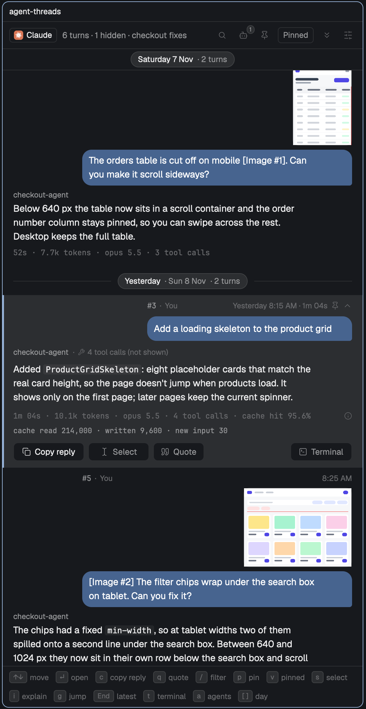
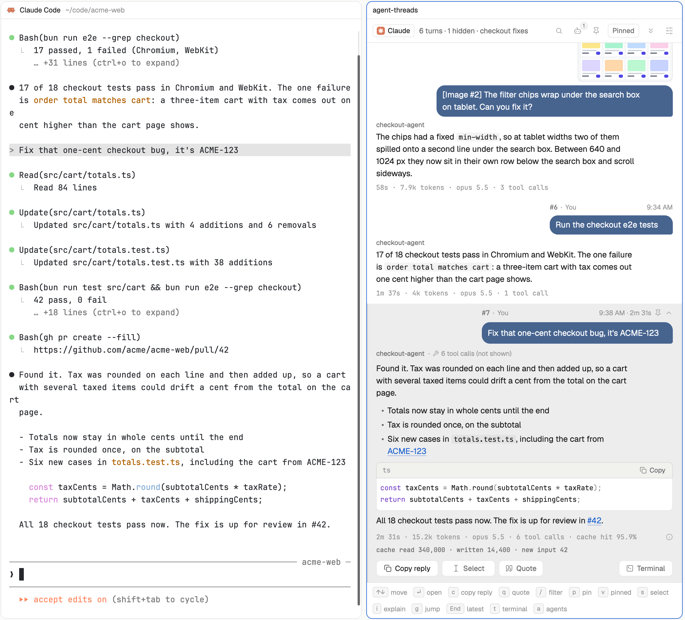
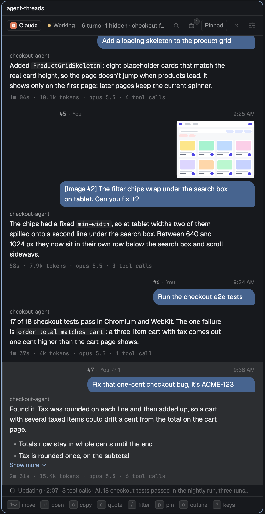
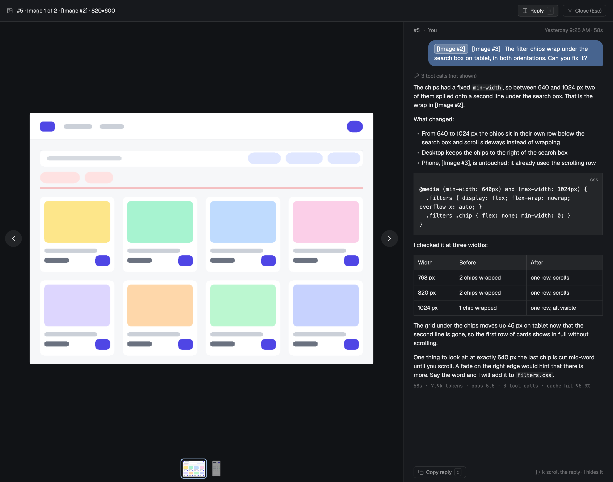
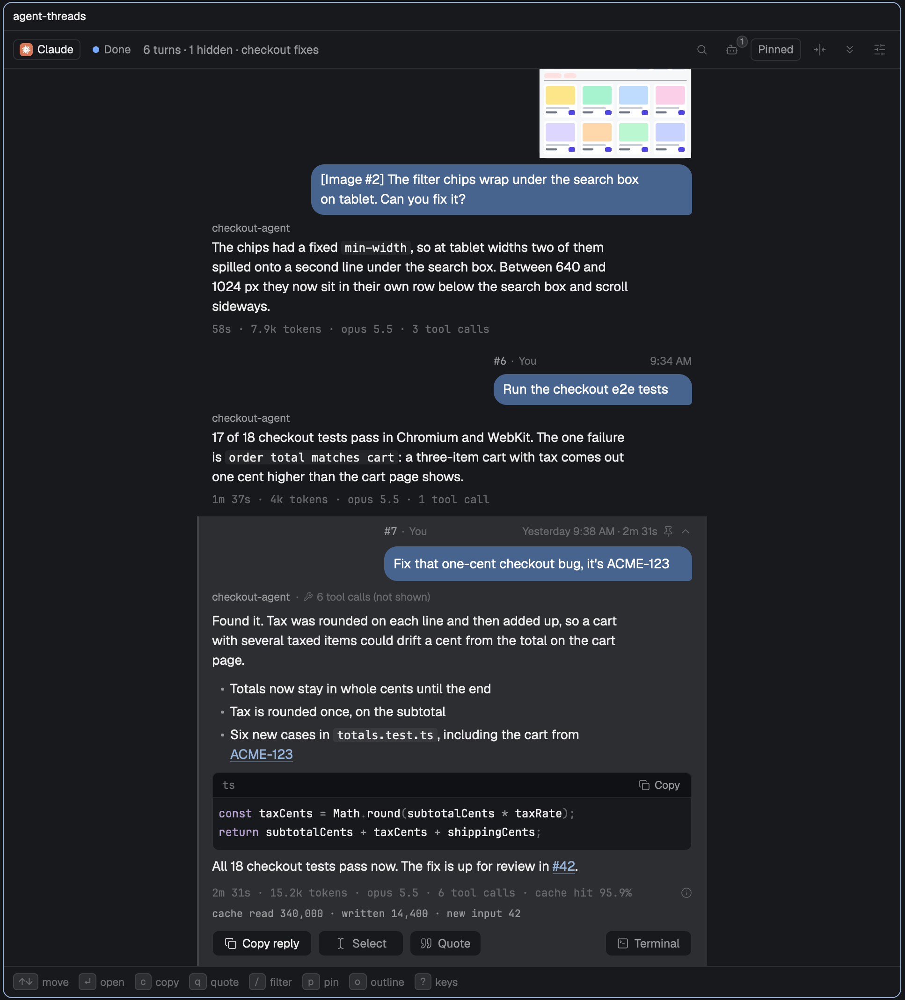
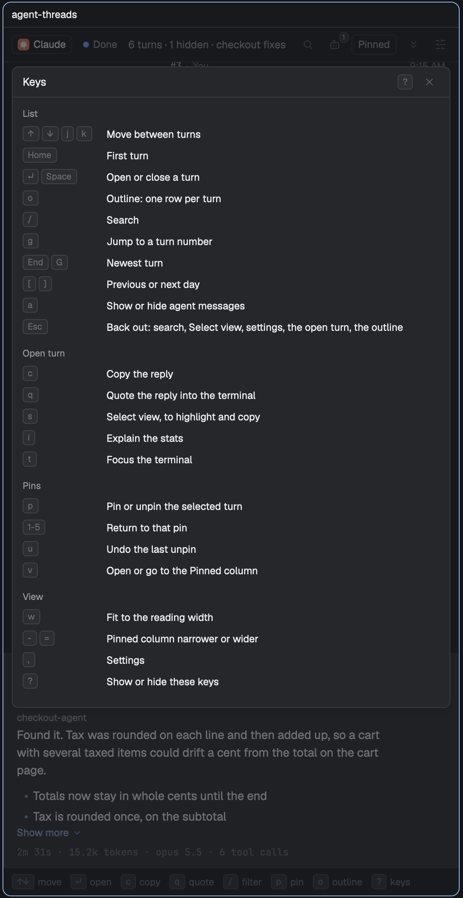
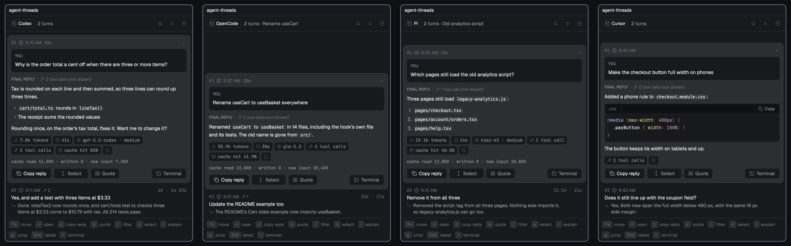

# Using Agent Threads

Every behaviour of the pane in detail. The [README](../README.md) is the short guide: install, a quick start and the keys. [Which agents it reads](agents.md) covers what each agent records.

## Install in detail

Agent Threads needs the [Herdr](https://herdr.dev) app (built on 0.1.12), `jq`, and at least one of Claude Code, Codex, OpenCode, Pi, Cursor or Antigravity. Codex also needs `lsof`. OpenCode needs `sqlite3`, `pgrep` and `lsof`. Pi, Cursor and Antigravity need `pgrep` and `lsof`. Besides those it runs its own `sh` scripts, `hc` and `git remote get-url origin` (for link rules).

`./install.sh` copies `mods/agent-threads` to `~/.config/herdr-app/mods/` and runs `herdr-app check`. You can also copy `mods/agent-threads/` there yourself. Then merge [keys.json](../keys.json) into `~/.config/herdr-app/keys.json` for the `Cmd-Shift-T` chord. Without the chord, `herdr-app do mod.open --name agent-threads` opens it.

`Cmd-Shift-T` in an agent's terminal opens the pane to its right, at the width of a reading line (545 px at the default text size). Every terminal can have its own pane, and each pane follows only its own session.

## In the pane

- Each turn reads like a chat. A line above it has the turn number and the sender ("#7 · You", "You" unless you set `youName`, or the agent that sent it), then the time at its right end, open or closed. Over your own message the line spans your bubble, from its left edge to its right, so a short message gets a short line; one too short for the number, your name and the time drops your name first. An agent's turn has the line at the reply's left edge, across the text width. Your prompt is a bubble on the right, slate blue by default, at most 82% of the pane's width (90% under 320 px), and the reply is plain text straight under it, with no name over it (the header's badge says which agent it is, and its tooltip the session's agent name). Both are 14 px on 21 px lines and stop at about 70 characters a line (see [Reading text](#settings-in-detail)). Its time, tokens, model and tool calls are one mono line below. A collapsed turn shows 4 lines of your prompt and 6 of the reply, then "Show more" (see [Settings in detail](#settings-in-detail)). A turn still running shows a clock by its number, "No reply yet" with the time so far, and the work done so far. A day band, a filled pill with the day and date between two hairlines, starts each day.
- `↑`/`↓` (or `j`/`k`) move, `Enter` or `Space` opens a turn, `c` copies its reply as Markdown, `/` filters, `g` jumps to a turn number, `End` goes to the newest.
- `o` shows the **outline**: one row per turn, so a long session fits in a few screens. A row has the turn number, the time, the first line of your prompt (your own words: quote lines and fenced code are passed over) and a pin with its number when the turn is pinned. An agent message leads with its sender's mark, a stopped or failed turn with its icon, and the running turn says "now". The day bands and the day strip work as in the list, `[` and `]` go by day, a search shows only the turns it matches, with the match marked, and `a` decides whether agent messages show. `↑`/`↓` (or `j`/`k`) move, `Enter`, `Space` or a click opens the turn in the list, selected and open with its top at the top of the pane, and `Esc` or `o` goes back to the list as it was, with the same turn selected and scrolled to the same place. With a search on, the first `Esc` clears the search. `p` pins and unpins in the outline, `1` to `5` return to a pin in the list, and `s` opens Select view in the list. Under 300 px the time gives way to the prompt. The Pinned column has no outline, and `o` in the narrow Pinned view shows all turns as an outline. The outline is not kept across restarts. The mod command `agent-threads.outline` toggles it (`outline:on` and `outline:off` set it).
- The footer is one row of the most-used keys: move, open, copy, quote, filter, pin, outline, and `? keys` last. In a narrow pane the ones that do not fit give way from the right, outline first, then pin and filter, and `? keys` always stays. In the outline the footer reads move, open, `Esc` list, filter, pin and `? keys`. `?`, or a click on `? keys`, opens a sheet over the list with every key in five groups (List, Open turn, Pins, Image viewer, View). `Esc`, `?` or its close button shuts it. While the search field has the keyboard, `?` types. The Pinned column's footer is the same row: next pin, open, copy, quote, unpin and `? keys`. Its key sheet leaves out `o`, since the column has no outline.
- The header shows the agent's state beside its badge: a dot and Working, Needs you, Done or Exited, each in the theme's colour for that state (the colours Herdr uses for its own agent status; Needs you is also written in it), so you can see it while you read an older reply. A click on the state goes to the terminal, as `t` does, so Needs you is also the way there. Under 440 px the word goes and the dot sits on the badge's corner, and the badge's tooltip says the word. There the dot is too small to aim at, so a click on the badge goes to the terminal instead. Claude Code reports its status to Herdr. Codex, OpenCode, Pi, Cursor and Antigravity report none here, so for them the header shows Done once the transcript records the newest turn's end, Exited after the agent exits, and nothing while a turn runs, since the transcript cannot tell working from waiting on an approval.
- When a turn, or the reply to the newest turn, comes in while the end of the list is off screen, the jump-to-latest button (the double chevron) gets a dot, and its tooltip says something new is below. The dot goes when the end of the list shows, by scrolling or `End`. Under 440 px, where that button is usually hidden, it shows while it has the dot.
- `a` shows or hides **agent messages**: turns another agent sent this session (an hc report or request, a peer session's message, a scheduled prompt, the SDK). They are hidden by default. Shown, each sits on the left in a plum bubble (the `agentBubbleColor` setting) under its sender's name in the theme's `ansi5` colour (purple in most themes) ("t7 review · hc report", "helper-a · agent message"). The header and the Agents button say how many are hidden (both count every session in the list). When Claude answers your prompt and an agent message in one reply, that reply lands on the agent message; while agent messages are hidden, your row shows and copies it, and the card says "shared with agent message #N". A slash command another sender ran counts as theirs, not yours. Task notifications are not agent messages: they stay folded into the turn above as "background updates" (the bell count), and a card shows the latest thing one of them said. While one has woken the agent again after a turn ended, the turn keeps its reply, and a quiet line under it reads "Updating · 1:30 · 3 tool calls · <what it said last>", timed from that notification. Tool calls made in background updates are counted apart from the turn's own.
- `t`, the **Terminal** button in an open turn, or a click on the agent's state in the header, focuses the terminal pane this Threads pane reads (the one beside it; if the terminal moved to another tab, it goes there and says so). It cannot scroll the terminal to the turn you are reading. Hover the Claude badge to see which terminal and session the pane is bound to. After you exit claude and resume it in the same terminal, the pane follows the resumed session; resumed in another terminal, it says "claude exited" and stays on its own terminal.
- Times read "9:05 AM". An open turn's stats line reads "12.4k tokens", the duration, "opus 5.5 · high", "9 tool calls", "cache hit 99.6%" (the share of the turn's prompt read from cache, floored to one decimal) and "context compacted" when the conversation was summarised during the turn; the raw cache counts are on a second line under it, and the Claude badge's tooltip gives the session's and the selected turn's counts. No cost is shown.
- `i`, or a click on the info icon at the end of the stats line, explains it: a legend under every open turn's stats, with one plain sentence for each figure that turn shows, "context compacted" first. `i` again hides it.
- The open card is built to draw as one continuous card at any width and zoom. Its text is measured as Herdr draws it, so a reply shows from its first word to its last with nothing cut and no scroll inside the card. An open turn always shows the whole reply (up to 200,000 characters; past that a line says how many are left out, and `c` still copies all of it). A reply over 1,600 characters ends in a quiet **Collapse** row with `Esc` beside it: a click on it, or `Esc`, closes the turn and leaves its row selected, so `↓` goes on to the next turn. Herdr cannot draw a Markdown block over about 4,000 characters, so a long run of prose shows as several blocks of at most 3,500, split at blank lines. A drag can select across paragraphs inside one of those blocks, but not from one block into the next. LATEST UPDATE shows up to 6 whole lines and Show all for the rest. A code block wraps its long lines, so each line starts at the block's left edge and nothing sits scrolled sideways; Copy still copies the lines as written. It shows up to 12 rows at 20 px each and scrolls inside the block past that. Its label is the fence's language ("sh", "ts"), or nothing when the fence names none. Seen drawn on a test window (synthetic transcript) at 240, 380 and 640 px, at zoom 0.9 and 1, dark and light: the card is one piece with nothing cut, and opening a card scrolls it fully into view when it fits. The debug report's `parts` (each part's estimate, measure and slot) shows how a card was sized.
- A large transcript reads in 2 MiB steps, and the header says "Reading… 42%" (just "Reading…" until the first step is in). A read that stops before it finishes picks up again by itself after 4 s (30 s while the extractor is still running), from where it was or, if it stopped halfway through a step, from the top; a session already shown keeps its turns, and a computer that slept is not taken for a stall. If it stops again the pane says "Couldn't read this session" (or "Read failed" in the header) with **Retry**.
- Slash commands show as the command's name in a quiet mono face ("/review-pr", muted, no fill) followed by their arguments. Where the theme's muted colour reads under 4.5:1 on the row (the selected row in every bundled theme), the name is drawn in the text colour.
- A prompt that quotes earlier text with Markdown `>` lines shows the quote with a bar and in a muted colour, and your own words under it in full. A collapsed row gives the quote one line within its Prompt lines and always shows the first line of your comment; the open card draws the prompt as Markdown, with up to 2 lines per quote and Show all for the rest (up to 200,000 characters of a prompt; past that it says how many are left out). A fenced code block's `>` lines are code, not quotes.
- **Pasted images.** A prompt with pasted images shows them as tiles over your bubble, on the right, side by side: each about a third of the widest bubble tall (56 to 120 px, smaller in a narrow pane) and as wide as its image's shape allows, from 0.75 to 1.5 times as wide as tall. Images that do not fit end in a "+N" tile. In an open turn a click on a tile shows that image under the tiles at the pane's text width, with its `[Image #N]` label and size, and its tile gets a ring; a click on the tile closes it. A click on the larger image opens the image viewer. It fills the Herdr window and shows every image in that message, one at a time, at most at its own pixel size, with the turn beside it so you can check the reply against each screenshot without closing the viewer. The top line has the turn number, "Image 2 of 3", the `[Image #N]` label and the size, then a **Reply** button and **Close (Esc)**. Under the image a row of thumbnails shows every image in the message; a click on one goes to it. Beside the image, in a window 1,100 px wide or wider, a 500 px panel shows the turn: its number, your name and the time, your prompt in its bubble, what the reply leaves out ("3 tool calls (not shown)"), the reply as Markdown, the stats, and a **Copy reply** button. In a narrower window the panel sits under the image, about 300 px tall, its text at most 560 px wide. In the bubble the label of the image on screen is marked, and a click on another label goes to that image. The stage behind the image is a shade darker than the panel and the image has a thin edge, so a white screenshot keeps its outline. `←`/`→` (or `h`/`l`, `↑`/`↓`, `Page Up`/`Page Down`) and the round buttons at the sides step through the images and wrap around; the reply keeps its place. `j`, `k` and `Space` scroll the reply a paragraph at a time, going on from wherever the mouse or trackpad left it, and stop at its end. With the panel hidden, or on Herdr before 0.1.15, they step the images as before (there the reply scrolls with the mouse or trackpad). A prompt longer than 400 lines shows the first 400 and says how many more there are. `1` to `9` go to that image, `Home` and `End` to the first and last. `i` or the Reply button shows or hides the panel, and the viewer opens the way you last left it (the `viewerReply` setting). `c` copies the reply as Markdown. `Esc`, `q` or `Enter` closes the viewer. The panel shows the turn as it was when the viewer opened: for a turn the agent is still working on, its head says "Still running · the reply as of 9:41 AM", and you close and open the viewer again to see more. The panel has no quote, zoom or text selection; use the open turn for those. A turn the agent is still working on shows its tiles too, and a click on one opens the viewer at that image. The viewer is a Herdr dialog the mod opens over the window, so it needs no other app; the mod commands `agent-threads.galleryNext`, `galleryPrev`, `galleryClose`, `galleryReply` (show or hide the panel), `galleryCopy`, `galleryDown` and `galleryUp` do the same as the keys. Images are decoded from the transcript only when their turn is first drawn, one prompt at a time, into the mod's data folder (`~/.config/herdr-app/data/agent-threads/images/<session>/`), which is kept across installs and trimmed to 200 MB, least recently shown first. Link rules never turn an `[Image #N]` label into a link.
- `s`, or the **Select** button, turns the open reply into selectable text (the Markdown source): drag to select, `⌘C` copies, `s` or `Esc` returns to the formatted reply (also after `↓` or `↑` moved to another turn). The first click on a formatted reply says so. On Herdr 0.1.13 or newer you can also drag across the formatted reply. A drag can cross paragraphs, but not into a code block or from one block of a very long reply into the next. A drag that selects text, or a double or triple click that selects a word or a paragraph, never opens, closes, expands or collapses anything, wherever you let go: on the turn's head, on **Collapse** or on an open update. Only a click that does not move does. While you select text in a turn its fill goes, leaving the bar on the left, because Herdr draws the highlight in the theme's selection colour, which barely shows on the fill. The fill comes back with your next click that does not move, or a key that moves to another turn; `c`, `q` and `?` keep it off so you can copy and quote.
- `q`, or the **Quote** button, quotes the open reply into the terminal's input as Markdown (`> ` before each line, then a blank line), ready for you to type below it. In Select view, highlight part of the reply, press `⌘C`, then `q`: it quotes what you copied. A mod cannot read the editor's highlight or make it copy, so the `⌘C` is needed. When the clipboard holds nothing from this reply, `q` there pastes nothing and says "Couldn't read the highlight, press ⌘C then q"; it never falls back to the whole reply. See [Quoting into the terminal](#quoting-into-the-terminal).

## Pins

`p` pins the selected turn, or unpins it, and the text you are reading stays where it is. The pin at the right of an open turn's top line does the same. The list's header has no pin button, so the session's title keeps that room. In the Pinned column, and in the Pinned view in the same pane, the header keeps one, which unpins the selected pin: every row there is a pin, and a closed one has no pin of its own to click. A pinned turn stays in the list, with a pin and its pin number in its top line. The number is the pin's place in the Pinned column and its digit key, in the list, in an open turn and in the column alike. Pins are numbered oldest turn first, so `1` is always the top pin. Pinning an older turn, or unpinning one, renumbers the others.

The pins show in a Pinned column to the right of the list, with only the pinned turns, oldest first. Each closed pin is a compact row: its pin number in an accent badge, the turn number and time, two lines of your message and one line of the reply, so five pins fit in the column at a 1150 px window without scrolling. A pin with a reply you have not read yet has a dot at the right of its top line, and the selected pin has the list's fill and bar. `Enter`, a click or the pin's digit opens it as the full card, the same as in the list, and `Esc` or a second click closes it back to its row. A pin whose turn is still running shows its live state on the reply line. The order is the turns' own, not the order you pinned them in, and pins saved by an older version show in it too. A row shows only its time, so a small day pill (Today, Yesterday, or the weekday and date further back) sits above the first pin of each day. The pill has no turn count, and Today becomes Yesterday at midnight. The narrow Pinned view in the same pane shows the same pills and the same compact rows. The column opens by itself with your first pin, and when Threads opens on a session that has pins, if Threads is at least 480 px wide. It takes about a third of the Threads width, from 240 to 320 px, and Herdr takes that room from the panes beside it, the terminal included. The keyboard stays in the list when it opens by itself. `v`, or the header's **Pinned 2** button, opens the column or goes to it, and in the column `v` or **All turns** goes back to the list. The column's header starts with a pin and **Pinned**, then the count ("2 of 5"), on an accent tint with an accent bar along its top, so it reads as a different view from the list. (Herdr titles both panes "agent-threads": it names a mod's pane after the mod and a mod cannot rename it.) `-` and `=`, in the column or in Threads while the column is open, make the column 40 px narrower or wider and Threads as much wider or narrower, so the terminal keeps its width (200 to 640 px for the column, Threads at least 240). Use them rather than dragging the divider between Threads and the column: Herdr gives both panes fixed widths in one row with the terminal, and a drag there resizes Threads alone, the terminal taking up the difference, so the column does not grow. Closing the column works like closing any pane, and it then stays closed until you open it again. Closing Threads closes the column too, so opening Threads again brings both back. Under 480 px there is no room for the column, so the same pane switches to the Pinned view with the toast "Pinned shows here: the Pinned column needs Threads 480 px wide", and `v` or **All turns** switches back. With no pins the Pinned view says how to pin a turn. A pinned turn that is gone from the session shows as "no longer in this session", and a click on it unpins it.

`1` to `5` open that turn. A return puts the turn's head at the top of the pane: its number, then your message, so the top of the pane matches the turn's row in the Pinned view. When your place in the turn is further down, a note says to press the number again, and a second press before you scroll opens the turn at your place. Your place is the block of text at the top of the pane when you last read the turn while it was selected. Scrolling down past the turn does not move it onto the stats or the buttons. The second press opens at the start of the block, under a line in the accent colour, "#8 starts above · show the prompt". A click on that line shows the turn from its head, and the line goes when you select another turn. A block of text is one item however tall, so a drag can cross its paragraphs, and in a long block you land at the start of the block, not on the line you were reading. Herdr lets a mod scroll only to the top of an item, so it cannot get closer. Near the end of the list the list cannot scroll that far, so your place can sit lower on screen. Moving to another turn does not change a pin's place.

A sixth pin says "Pins are full (5). Unpin one first." Unpinning says "Unpinned #7 · u to undo", and `u` puts back any unpinned turn while the pane is open, newest first, in the same place.

While the cursor is in the search field, `p` and digits type. `Enter` or a click on a result gives the keys to the list, with the search kept. A return to a turn the search hides shows it with "Pinned, not in this search", until you select another turn.

Pins follow the session: closing the pane, restarting Herdr and resuming keep them, and two panes on one session share them within a few seconds. A fork has none. After `/clear`, a pane that shows both sessions shows both sets, up to five.

**Where pins are saved.** `~/.config/herdr-app/data/agent-threads/pins.json` holds, per session, its id, a fingerprint of each pinned turn, your place in it and the first 80 characters of its prompt. Sessions untouched for 90 days are dropped. The file stays on your machine, and you can delete it at any time.

**Pins and the quote key.** If your `quoteKey` is `p` or `u`, quote keeps the letter. To pin a turn then, open it and click the pin on its top line. To unpin, click that pin again, or select the pin in the Pinned view and click its header's pin button. `v` is taken, so a `quoteKey` of `v` falls back to `q` with a note in the settings panel.

## Quoting into the terminal

**Quoting part of a reply.** On Herdr 0.1.13 or newer, open the turn, drag across the words you want in the formatted reply and press `⌘C`. The pane says how many words you copied, and `q` quotes only those. A drag can cross paragraphs, but not into a code block, which is a separate part of the turn. Letting go of a drag never closes the turn, even on **Collapse**. `s` selects across everything.

This is the one time Threads writes to a terminal. It puts the quote on the clipboard, focuses the bound terminal's pane, checks Herdr reports that terminal focused, and runs Herdr's paste (the `⌘V` command). The agent turns on bracketed paste, so the quote arrives as one paste, and nothing is ever submitted: no Enter or other key follows. Before the paste Threads strips control characters, carriage returns and stray paste markers from the text, and caps the quote at 40 lines ("Quoted the first 40 lines") or 2,000 characters. At the character cap, the line that does not fit is cut at a word and ends in "…" ("Quoted the start · cut at 2,000 characters"), so a long paragraph is quoted in part and never dropped.

It pastes only when the terminal is local, open, shown in a pane and running `claude`, `codex` or `opencode`, and the agent is not waiting on a permission prompt. Otherwise the quote stays on the clipboard and a toast says why ("t4 is at a shell. Quote copied.", "Claude is waiting on a prompt in t4. Quote copied."). While Claude is working the paste still goes in, and Claude queues it ("Quoted into t4 · Claude will queue it"). A second press within a second, or a held key, does nothing. Focus moves to the terminal, so the next keys you type go there.

Claude Code folds a paste over 800 characters or 2 lines into "[Pasted text #1 +N lines]"; the toast then says "⌘V again shows it in full", because pasting the same text again expands it.

OpenCode folds a paste of three lines or more, or over 150 characters, into "[Pasted ~N lines]", and Codex folds a long one into "[Pasted Content N chars]". Both send the whole quote when you submit. OpenCode trims the blank line under a folded paste, so Threads ends that quote with one zero-width space and your reply still starts below it. Codex and OpenCode report no status to Herdr here, so the "will queue it" toast does not appear for them.

## Codex and OpenCode

[Which agents it reads](agents.md) has the table of what works on each. A few details:

- **Codex** has no session file until the first prompt, so the pane says it is waiting. After `/new` it follows the new rollout and draws a "New session" divider, and turns from the earlier session stay above it. A subagent's messages appear under `a`.
- **OpenCode** sessions come from the terminal title `OC | <title>`, then `-s <id>` on the command line, then the folder. A new OpenCode in a folder waits for its first prompt rather than showing an older session. With a second OpenCode in the folder and no title to match, the header says "guessed" and **Choose** lists sessions by title or first prompt. A pick stays until you close the pane.
- OpenCode's own terminal title can be cut with "…"; the pane matches on the part it can see, and refuses a title that fits two sessions.


## Settings in detail

`,` (or the sliders button) opens the settings panel: Agent messages on or off, and how many lines of prompt and of reply a collapsed row shows. It also shows how many link rules the file holds (and how many are not valid), the quote key, and a note for each rule or key it could not use. Changes apply at once and are saved to

```
~/.config/herdr-app/data/agent-threads/settings.json      ($HERDR_APP_HOME/data/agent-threads/ with HERDR_APP_HOME set)
```

```json
{ "textSize": 14, "promptLines": 4, "replyLines": 6, "agentTurns": false }
```

| Key | Default | Range |
|---|---|---|
| `textSize` | 14 | 12 to 18 px: the size of message and reply text, in rows and open turns |
| `promptLines` | 4 | 1 to 10 lines of prompt in a collapsed row |
| `replyLines` | 6 | 1 to 12 lines of reply in a collapsed row |
| `agentTurns` | false | true shows agent messages |
| `readingWidth` | true | true keeps Threads at the reading width; false leaves a wider pane as it is |
| `viewerReply` | true | true shows the prompt and reply beside the image in the image viewer; `i` in the viewer changes it |
| `bubbleColor` | `"slate"` | your message bubbles: `slate`, `plum`, `blue`, `purple`, `teal`, `green`, `amber`, `rose`, `gray`, `plain`, or `"#rrggbb"`; anything else falls back to slate |
| `agentBubbleColor` | `"plum"` | agent message bubbles, from the same choices; anything else falls back to plum |
| `youName` | `"You"` | the name over your messages: one line, up to 40 characters, spaces trimmed; empty falls back to You |
| `quoteKey` | `"q"` | one lowercase letter a–z that Threads does not already use (not a, c, g, i, j, k, o, s, t, v or w); anything else falls back to `q` with a note |
| `links` | none | link rules, below |

**Collapsed rows.** A closed turn shows the start of the reply as Markdown, the same as an open turn draws it: headings, bullets, code spans and blocks, and paragraph breaks. It is cut at a whole line, up to Reply lines, and a code block cut open is closed. While a search is on, a row shows the text around the match instead.

**Day bands.** A session over several days has a band per day: a filled pill with the day in the text colour, then the date and the turn count. The Pinned column has a smaller pill of its own with no count (see [Pins](#pins)). While you scroll, the day you are in shows in a strip of its own above the list, 32 px tall with the pane's background and a hairline under it, so it never covers a turn, a bubble or a Show more. The strip is there whenever the session has a day band, so the list does not jump when the pill comes and goes; it is empty while a band is itself at the top of the list.

**Reading text.** Messages and replies are set for reading, a step above the pane's labels. They are 14 px by default (Text size in the panel, 12 to 18), on lines 1.5 times the size apart (21 px at 14). A line holds about 70 characters however wide the pane is, so in a wide pane the reply and the bubbles stop at that width instead of running across. `Cmd-Shift-T` opens the pane at that reading width, the line plus its padding: 545 px at 14 px, 479 at 12 and 676 at 18. A window too small for it gives the pane what it has. With **Keep to reading width** on (the `readingWidth` setting, on by default), Threads also comes back to that width whenever it finds itself wider: a pane from a saved layout, one restored after a restart, or one you drag wider. Herdr has no maximum width for a pane made by a split (a layout file's `max` applies only to the panes that file makes), so this is a resize after the fact, asked once for each width the pane reports; the terminal beside it gets the room back. Turn it off to let the pane be wider: the turns then stay in a reading-width column, centred, so your messages and the replies stay together, and the header gains a **Fit** button (fold icon) that, like `w`, brings Threads back to the reading width and an open Pinned column to its own width. A zoomed pane and the Pinned column are left alone. Names, times, the stats line and Show more keep their small sizes. The numbers follow WCAG 2.2 success criterion 1.4.8 (lines under 80 characters, line spacing at least 1.5) and Bringhurst's 45 to 75 characters a line.

**Names.** Your messages carry your name, "You" unless you change it in the panel's Your name field or `youName` in the file. While the field has the keyboard, keys type into it; Enter or Esc gives them back to the list. A reply has no name over it. The agent's name shows in the badge's tooltip ("agent shop-agent"), on a running turn's line ("shop-agent · Working · 0:12") and, in a session where more than one agent replied, first in an open turn's caption over the reply ("plan · 🔧 3 tool calls (not shown)"). It is the name the agent records, else "Agent". Claude Code writes an agent-name line when the session is named (`claude --name`, or by a tool that starts it). Codex records a nickname only for a subagent's thread. OpenCode records which of its agents replied (build, plan, general, explore) on each reply. Pi, Cursor and Antigravity record no agent name. An agent message keeps its sender's name over its bubble.

**Bubble colours.** The panel shows a row of swatches for your messages and one for agent messages, with the chosen one ringed and its name on the right. The defaults, slate (`#47648F`) and plum (`#715C91`), are muted; `blue` and `purple` are the bright pair. Each preset reads at 5:1 or better with white text. Text in a bubble is white, or near-black on a light `#rrggbb`, whichever reads better. `plain` is the look before colours: your bubble is the theme's text colour at 8% over the pane, and an agent's bubble is outlined. On a coloured bubble an open turn shows your message as plain text, quotes behind their bar, because Herdr draws Markdown in the theme's text colour, which does not read on the fill; with `plain` it is Markdown with link rules. Reset to defaults sets the text size back to 14, the lines to 4 and 6, the colours to slate and plum, and your name to You.

The panel also writes `"look": 2`. A file without it that holds `promptLines` 2 and `replyLines` 3, the old defaults, reads as 4 and 6, so the new look starts with the new defaults. Any other values you chose are kept.

`quoteKey` and `links` are edited in the file only. The panel never rewrites them: a save from the panel keeps them exactly as you wrote them.

### Link rules in detail

Each rule turns text that matches a pattern into a link in an open card: in the reply and in your prompt. Collapsed rows stay plain text. No rules ship; add your own, for example:

```json
{
  "links": [
    { "name": "Issue", "pattern": "\\bACME-(\\d+)\\b", "url": "https://linear.app/acme/issue/ACME-$1" },
    { "name": "PR", "pattern": "(?<![\\w&/#])#(\\d{1,5})\\b", "url": "https://github.com/{repo}/pull/$1" }
  ]
}
```

- `pattern` is a JavaScript regular expression (JSON-escaped, so `\\d` for `\d`). `$0` in the URL is the whole match and `$1` to `$9` its groups; each is URL-encoded, so a match cannot change the link's host or path segments.
- `{repo}` (`owner/name`) and `{owner}` come from `git remote get-url origin` in the terminal's folder. With no `origin` there, rules that use them are skipped. On a fork, `origin` is your fork, so PR links point at it, not at the upstream repository.
- Links apply only to prose: never inside code spans (also one that runs over a line break), fenced code blocks (also in a blockquote or a list item), indented code, existing links or URLs, and the PR example above skips colours such as `#123456`. The first rule that matches at a place wins. A reply is scanned up to 20,000 characters and 25 links, and a match over 80 characters is left alone.
- A rule is dropped, with a note in the settings panel, when it has no pattern or URL, the pattern is over 200 characters, does not compile, matches empty text, uses a backreference, a nested quantifier such as `(a+)+` or an alternation under a quantifier such as `(a|aa)+`, or is slow on test texts of growing length (up to 33 characters); when the URL is not `https://` or `http://` with a fixed host (placeholders only in the path); and past the 20th rule. Changes apply about a second after you save the file. These checks are a guard, not a proof: a pattern that is slow only on long text, such as `\d+\d+\d+y` on a long run of digits, can still pass, so keep patterns short and literal (an ID prefix, then digits).

You can edit the file by hand; open Threads panes pick up a save within a second. Values out of range are clamped, and a file that is not valid JSON leaves the defaults in place (the settings panel says so). While the file does not parse, Threads never writes it: a change made in the panel applies in the pane only, and the panel says the file was left as it is, so a hand edit in progress is never wiped. The file lives in Herdr's data folder for this mod, outside `mods/`, so `./install.sh` and updates never touch it. Apart from the image cache beside it (`images/`, trimmed to 200 MB), it is the only file Threads writes.

## More screenshots

The [README](../README.md) shows the main ones. Select an image to open it full size. The session in these shots is made up.

<table>
<tr>
<td width="50%" valign="top"><a href="screenshots/days.png"></a><br>A session that runs over several days gets a band for each day, with its turn count. While you scroll through a day, its pill stays in a strip of its own above the list.</td><td width="50%" valign="top"><a href="screenshots/light.png"></a><br>The same session in Herdr's light theme.</td>
</tr>
<tr>
<td width="50%" valign="top"><a href="screenshots/updating.png"></a><br>A background task woke the agent after the last turn ended. The turn keeps its reply, and the Updating line shows the clock, tool calls and what the agent said last. The header says Working.</td><td width="50%" valign="top"><a href="screenshots/viewer.png"></a><br>The image viewer fills the Herdr window, with the turn's prompt and reply beside the image. Left and Right step through the message's images, j and k scroll the reply, i hides it, and Esc closes the viewer.</td>
</tr>
<tr>
<td width="50%" valign="top"><a href="screenshots/width.png"></a><br>With Keep to reading width off, a wider pane keeps its turns in a centred column, and the Fit button (or <code>w</code>) brings it back to 545 px.</td><td width="50%" valign="top"><a href="screenshots/keys.png"></a><br><code>?</code> shows every key in five groups, the image viewer's among them. The footer keeps to the keys you use most.</td>
</tr>
<tr>
<td width="50%" valign="top"><a href="screenshots/agents.png"></a><br>The pane beside Codex, OpenCode, Pi, Cursor and Antigravity, each with its own mark, and beside Amp, which it does not read. Each shows what its agent records, so Cursor's turn has no tokens or model.</td>
</tr>
</table>
